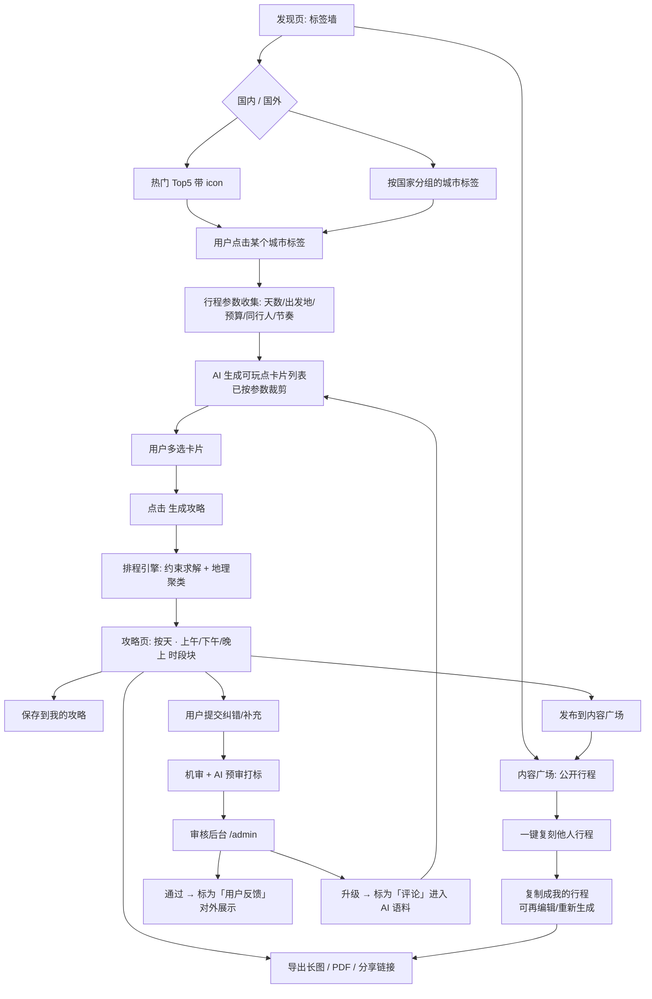
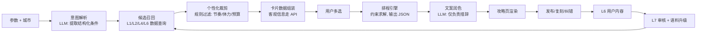

# AI 旅行攻略生成器 · 初期需求文档

| 项目 | 内容 |
|---|---|
| 文档版本 | v0.4(新增大模型选型章节,明确 DeepSeek 模型与调用规范) |
| 文档状态 | 待评审 · 存在 12 个待决策项(见第 11 章,其中 Q9 已决策) |
| 产品形态 | Web 优先,手机 + 桌面浏览器自适应 |
| 项目性质 | 个人作品 / 练手项目,以"先把东西做出来"为第一优先级 |
| 核心命题 | 把"我想去某地玩"到"一份可直接执行的行程"之间的决策成本降到接近零 |
| v0.2 变更 | ① 原非目标的"社区 / UGC"升级为正式目标;② 新增 5.6 章 UGC 与攻略复用;③ 新增数据反哺闭环(6.3);④ 数据结构与分期同步调整 |
| v0.3 变更 | ① 新增 5.7 章审核后台;② UGC 纠错改为「用户原文展示 + AI 意向判定」,取消改写环节;③ 明确**展示层与语料层分离**;④ Q9 决策完成 |
| v0.4 变更 | ① 新增 6.5 章「大模型选型与调用规范」;② 确定**全链路统一使用 `deepseek-v4-flash`**;③ 成本估算改为基于真实单价计算;④ 新增 Q13(思考 token 成本) |

> 阅读提示:第 10 章"范围分期"与第 11 章"待决策问题"是本文档最需要你先拍板的部分。你在问答中勾选的范围略大于"个人作品"这个目标所能承载的量,我在第 10 章给出了收敛建议,但保留了你选择的全量目标作为后续阶段。

---

## 1. 项目背景与目标

### 1.1 背景

规划一次旅行,用户的真实痛点不是"找不到信息",而是**信息太多、无法收敛**:

- 攻略平台给的是海量碎片内容,需要用户自己拼装成行程;
- 通用大模型能写攻略,但输出是一篇**文章**,不是**可执行的日程**;
- 用户真正卡住的环节是"这个城市有哪些可玩点、哪些值得去、我 5 天到底够不够、怎么排不累";
- 而已有的行程分享形态(长图、帖子)**无法被复用**——看到别人的好行程,用户只能手动抄一遍。

### 1.2 产品目标

| 层级 | 目标 |
|---|---|
| 用户目标 | 5 分钟内,从一个城市名得到一份按天排好、理由明确、可直接照着走的行程 |
| 产品目标 | 跑通「发现 → 选点 → 生成攻略」的完整闭环,并让"优缺点"这一栏成为产品的记忆点 |
| **社区目标** | 让用户生成的行程可被他人**一键复刻**,并让用户的反馈**反哺 AI 语料**,形成数据飞轮 |
| 项目目标 | 完成一个可对外展示、可真实使用的作品级产品(不追求首版商业化) |

> **关于 UGC 的定位说明**
> 本项目把 UGC 定义为「**攻略复用 + 内容反哺**」,而不是做社交社区。两者的关键差异是:前者**在零用户时依然成立**——哪怕只有你一个人在用,你的纠错也在让数据变准;后者必须依赖流量才能不显得空。
> 这是本产品选择该 UGC 形态的核心依据,也是第 5.6 章所有需求的设计前提。

### 1.3 非目标(明确不做)

- 不做预订(机票、酒店、门票交易)
- **不做社交关系链**:没有关注、粉丝、私信、个人主页
- **首版不做图文游记发帖**:UGC 形态收敛为"分享已生成的攻略 + 他人可一键复刻 + 对 POI 纠错补充"
- 不做行程中的实时导航与天气预警(预留扩展位)
- 首版不做多语言

---

## 2. 目标用户与核心场景

### 2.1 目标用户

| 用户类型 | 特征 | 核心诉求 |
|---|---|---|
| 主力:自助游规划者 | 20–35 岁,自由行,有一定信息检索能力 | 快速得到一份靠谱行程骨架,再自行微调 |
| 次主力:多城联游者 | 假期较长,一次去 2–3 个城市 | 城市之间的时间分配与先后顺序 |
| 长尾:决策困难者 | 只确定了目的地,完全不知道玩什么 | 先被"可玩点卡片"启发,产生兴趣 |
| **新增:行程复用者** | 懒得自己排,或想参考他人安排 | 直接看到别人的成品行程,一键复刻后微调 |
| **新增:内容贡献者** | 刚旅行回来,踩过坑,愿意说两句 | 低成本地纠错、补充、分享自己的行程 |

### 2.2 核心场景(用户故事)

1. **作为** 计划去澳大利亚玩 8 天的用户,**我希望** 先看到悉尼、墨尔本有哪些可玩点,**以便** 决定每城待几天 → 于是有了"多城市联游"需求。
2. **作为** 第一次去东京的用户,**我希望** AI 告诉我每个热门点的"好处和坏事"(比如"网红但排队 1 小时"),**以便** 我判断值不值得去。
3. **作为** 带父母出行的用户,**我希望** 行程不要太满、不要爬山,**以便** 老人跟得上 → 于是有了"节奏 / 同行人"偏好输入。
4. **作为** 已经排好行程的用户,**我希望** 把它导出成一张长图/链接发给同伴,**以便** 大家对齐安排 → 于是有了"导出分享"需求。
5. **作为** 懒得从零规划的用户,**我希望** 看到别人排好的悉尼 5 天行程,**并一键变成我自己的**行程,**以便** 我只改动几个点就出发 → 于是有了"一键复刻"需求。
6. **作为** 刚从悉尼回来的用户,**我希望** 用一句话说说我的真实体验,**以便** 后来的人不被过时信息误导 → 于是有了"UGC 纠错"需求,AI 会自动判断我是在点赞还是点踩,同时这条内容反哺了 AI 语料。
7. **作为** 看到别人行程里有个我不知道的小众点的用户,**我希望** 把这个点存进我的规划里,**以便** 下次去墨尔本时用上 → 于是有了"从他人行程收藏 POI"需求。
8. **作为** 产品管理员(你自己),**我希望** 有个简单的后台处理用户提交与举报,**以便** 内容可控、语料不被污染 → 于是有了第 5.7 章"审核后台"。

---

## 3. 产品定位与价值主张

**一句话定位**:一个把"城市"直接翻译成"可执行行程"的 AI 旅行规划器,并且**你排好的行程可以直接被下一个人用**。

**四个差异化支点**

1. **卡片化决策,而不是文章阅读** —— 每个可玩点是一张可多选的卡,用户在做选择题,不是在做阅读理解。
2. **每个点都敢说缺点** —— 不只夸好,明确列出"不好的一面",并对每条信息标注来源。
3. **排程是算出来的,不是写出来的** —— 时长、通勤、开门时间、体力曲线作为约束参与计算,而非靠模型自由作文。
4. **行程是可复用的,不是一次性的** —— 别人的行程能一键变成你的,而每一次使用和纠错都让 AI 变得更准。这是本产品从"工具"走向"内容资产"的路径。

---

## 4. 核心用户流程



**关键流程决策(已确认)**

| 决策点 | 结论 |
|---|---|
| 行程参数何时收集 | **点进城市后先收集,再展示可玩点**。这样可玩点列表本身就是个性化裁剪过的结果,而不是全量罗列 |
| 攻略交付形态 | 按 **上午 / 下午 / 晚上** 时段块排布,不精确到具体时刻(避免伪精确导致翻车) |
| 是否支持多城市联游 | **支持**。用户可一次选择多个城市,系统分配各城天数 |
| 标签层级 | **国家 → 城市**(`country → city → poi`),点击城市直接进入可玩点页 |
| 生成后可否编辑 | 首版攻略为**只读 + 重新生成**;支持单点"替换/移除"为 P1 |
| UGC 形态 | **攻略分享 + 一键复刻 + POI 纠错补充**;不做发帖、不做关注关系 |
| UGC 审核 | **先发后审 + 举报 + 敏感词机审** |
| **UGC 展示方式** | **展示用户原文**,不做人工改写;由 AI 判定该条属于"点赞(优点)"还是"点踩(缺点)"后分类展示 |
| UGC 反哺 AI | **反哺**。用户内容进 L3 语料,满足条件可将来源标记升级为 `评论` |
| UGC 冷启动 | **AI 批量生成一批种子内容并明确标注 `AI 综合`** |
| **审核后台** | **集成在主应用的隐藏路由 `/admin`**,由管理员(你自己)处理 UGC 与举报 |
| **AI 预审** | **启用**。提交内容先由 LLM 打标(广告嫌疑 / 重复 / 情绪化 / 建议结论)再进人工队列 |

---

## 5. 功能需求详述

### 5.1 页面一:发现页(标签墙)

**目标**:3 秒内让用户找到感兴趣的目的地,并感知"这里内容很多"。

#### 5.1.1 结构

| 区块 | 内容 | 说明 |
|---|---|---|
| 顶部切换 | `国内` / `国外` 分段控件 | 切换不刷新整页,仅重排下方内容 |
| 热门区 | 当前 Tab 下的 **Top5** 城市标签 | 带小 icon(如 🗼 🌊 🏔️),标签视觉权重高于普通标签 |
| 全量区 | 按国家/地区分组排列的城市标签 | 国外按国家分组(澳大利亚:悉尼、墨尔本;新西兰:奥克兰、皇后镇…) |
| **广场入口** | 顶部或底部一个「大家的行程」入口 | 进入内容广场(见 5.6.4),冷启动阶段内容不足时**可隐藏该入口** |
| 底部 | 版权 / 免责声明 / 反馈入口 / 用户协议 / 隐私政策 | 旅游信息类 + UGC 产品的必备合规项 |

#### 5.1.2 交互需求

| 编号 | 需求 | 优先级 |
|---|---|---|
| F1-01 | 点击标签跳转到该城市的可玩点流程页 | P0 |
| F1-02 | 热门 Top5 按真实热度数据排序,并展示排名或热度标识 | P0 |
| F1-03 | 标签支持 hover / active 微动效,点击有即时反馈(≤ 100ms 视觉响应) | P1 |
| F1-04 | 支持按城市名搜索(输入「悉尼」直接定位) | P1 |
| F1-05 | 城市标签支持"已去过/已规划"状态标记 | P2 |
| F1-06 | 内容广场入口,展示公开行程数量(有内容才展示,避免空入口) | P0 |

#### 5.1.3 热度数据来源(已确认:真实数据)

| 区域 | 候选数据源 | 采集方式 |
|---|---|---|
| 国内 | OTA 榜单(携程/马蜂窝目的地榜)、搜索引擎指数、社媒话题热度 | **离线 ETL + 定时(周级)刷新**,结果落库 |
| 国外 | Google Trends、TripAdvisor / Google Places 的评分与评论量 | 同上 |
| 站内行为 | 站内城市点击量、攻略生成量、复刻量 | 本地统计,冷启动后逐步替代纯外部数据 |

> **架构决策**:热度数据走「离线抓取 → 落库 → 前端只读」,不在请求时实时调外部接口。理由:成本可控、抗限流、可人工干预兜底。代价是天级延迟,对旅游决策场景无影响。
>
> **合规提示**:优先使用官方开放 API 与公开榜单;若需抓取,严格遵守 robots 协议与频率限制,首版建议**人工季度校准 + 少量合规接口**混合。此项属于外部依赖风险,见第 9 章。

---

### 5.2 页面二:可玩点选择页

**目标**:让用户用"做选择题"的方式完成行程决策,并理解每个选择的原因。

#### 5.2.1 流程

```
进入该页 → 弹出/内嵌「行程参数表单」→ 提交 → AI 生成可玩点卡片 → 用户多选 → 点「生成攻略」
```

#### 5.2.2 行程参数表单(已确认字段)

| 字段 | 类型 | 必填 | 默认值 | 说明 |
|---|---|---|---|---|
| 天数 | 数字 / 快捷选项(3/5/7/10天) | 是 | — | 多城市联游时为总天数 |
| 出发地 | 城市输入框 | 否 | 空 | 用于估算首日到达时间 |
| 预算 | 档位选择(穷游/标准/舒适/奢华)或人均金额 | 否 | 标准 | 影响推荐点的价格带与用餐建议 |
| 同行人 | 单人/情侣/朋友/亲子/带父母 | 否 | 朋友 | 影响体力负荷、夜生活类点位的增减 |
| 节奏 | 松弛(2–3点/天)/ 标准(3–4点)/ 特种兵(5–6点) | 否 | 标准 | 直接决定每天排几个点 |

> **设计原则**:除天数外全部可跳过。跳过则使用默认值,且默认值需在生成结果页显式回显(让用户知道"系统按标准节奏排的",而不是黑箱)。

#### 5.2.3 可玩点卡片

每张卡片包含以下信息块:

| 信息块 | 内容 | 数据来源 |
|---|---|---|
| 图片 | 1 张主图(多图轮播为 P1) | 第三方 POI / 图库 API |
| 名称 | 中文名 + 原文名(如 悉尼歌剧院 / Sydney Opera House) | 人工校准景点库 |
| 一句话简介 | ≤ 40 字 | LLM 生成 |
| **好处** | 2–3 条,每条带来源标记 | 见下方来源体系 |
| **坏事** | 1–3 条,每条带来源标记 | 见下方来源体系 |
| 建议时长 | 如「2–3 小时」 | 人工校准 / LLM 综合 |
| 客观信息 | 门票、开放时间 | **第三方 API**(有则展示,无则隐藏,不猜) |
| 体力负荷 | 轻松 / 中等 / 高强度 | 人工校准 |
| 适合人群 | 标签(亲子友好 / 适合拍照 / 需爬山…) | 人工校准 |
| 地理位置 | 经纬度 + 区域名(如「环形码头区」) | 第三方 POI API |
| **用户实践** | 用户提交的原文短评 + 意向标签 + 实拍图(有则展示) | UGC(见 5.6.3) |
| 选择状态 | 可多选,显示已选数量 | — |

#### 5.2.4 可信度与来源标记体系(**已确认:必须带来源标记**)

每条"好处/坏事"后必须携带以下标记之一,UI 以不同颜色小标签呈现:

| 标记 | 含义 | 来源 | 视觉 |
|---|---|---|---|
| `官方` | 来自景点官网/官方发布 | 官方信息 | 蓝色 |
| `评论` | 来自真实用户评论的归纳(含**被多位用户交叉验证过的 UGC**) | 评论语料 / UGC 升级 | 绿色 |
| `用户反馈` | 本站用户提交的**原文短评**,已过机审与抽检,尚未达到交叉验证条件 | UGC | 橙色 |
| `AI 综合` | 模型基于公开知识归纳,**未经核实** | LLM | 灰色 |

> **`用户反馈` 是 UGC 与可信度体系的连接点**。用户提交的内容不会立刻获得"可信"身份,必须先经过审核与验证(规则见 5.7、6.3),这样既鼓励贡献,又不让语料被单条主观内容污染。

配套需求:

| 编号 | 需求 | 优先级 |
|---|---|---|
| F2-01 | 每条优缺点条目 hover 显示来源详情(如"来自 XXX 平台近 90 天 230 条评论") | P0 |
| F2-02 | 每张卡片提供「这条不对」举报入口,写入反馈表 | P0 |
| F2-03 | 卡片底部统一免责声明:「信息由 AI 综合生成,出行前请以官方信息为准」 | P0 |
| F2-04 | 客观信息(门票/开放时间)标注"更新于 YYYY-MM-DD" | P1 |
| F2-05 | 无真实数据支撑的字段**直接不展示**,不使用 AI 猜测值填充 | P0 |
| F2-06 | 「补充/纠错」入口:用户可提交一句原文短评,并可上传实拍图 | P0 |
| F2-07 | 用户提交内容需登录,展示提交者昵称与时间 | P0 |
| F2-08 | `用户反馈` 条目展示意向图标:👍 表示"值得去"、👎 表示"要避坑",由 AI 判定 | P0 |
| F2-09 | `用户反馈` 条目右下角提供「我也遇到了」/「这条不准确」按钮 | P0 |

#### 5.2.5 其他交互需求

| 编号 | 需求 | 优先级 |
|---|---|---|
| F2-10 | 卡片默认按"综合推荐度"排序,支持按时长 / 体力 / 价格切换排序 | P1 |
| F2-11 | 支持按分类筛选(景点 / 美食 / 体验 / 自然 / 购物) | P1 |
| F2-12 | 已选数量常驻底部,并提示"已选 5 个,约需 2.5 天" | P0 |
| F2-13 | 已选数量与可用天数严重不匹配时给出提示(如"已选 12 个,3 天排不下,要不要精简?") | P0 |
| F2-14 | 一键"帮我随机挑几个"降低选择困难 | P2 |
| F2-15 | 生成过程中的等待体验:流式输出 / 骨架屏 / 进度文案(生成耗时可能 10–20s) | P0 |
| F2-16 | 卡片标记"已被 N 个行程采用"(来自 UGC 行为的复用热度) | P1 |

**页面二的核心风险与对策**:用户可能什么都想选,导致后续排程被迫压缩到不可执行。
对策:`F2-12 / F2-13` 的实时"时间预算"提示是**关键交互**,必须在 P0 落地。

---

### 5.3 页面三:攻略生成页

**目标**:交付一份可以直接照着走的行程。

#### 5.3.1 排程逻辑(产品最核心的算法资产)

**输入**:选中的 POI 集合 + 行程参数(天数、出发地、预算、同行人、节奏)
**输出**:结构化日程 JSON(而非一段文字)

**硬约束(必须满足)**

| 约束 | 规则 |
|---|---|
| 每日点位数量 | 按节奏:松弛 2–3、标准 3–4、特种兵 5–6 |
| 单日通勤上限 | 城市内总通勤 ≤ 90 分钟(自驾/包车行程另算) |
| 地理聚类 | 同一天的点位必须落在同一区域,禁止来回穿城 |
| 用餐时段保留 | 午 12:00–13:30、晚 18:30–20:00 不排景点 |
| 到达/离开日折算 | 首日与末日按 0.5 天计算,不排满 |
| 开放时间窗口 | 有官方数据的 POI 必须落在开放时间内 |
| 预算约束 | 门票 + 交通估算不超过用户预算档位 |

**软约束(打分择优)**

| 约束 | 说明 |
|---|---|
| 偏好匹配度 | 与同行人 / 节奏 / 预算的匹配程度 |
| 热度 | 热门点优先放在体力最好的时段 |
| 体力负荷曲线 | 避免连续两天高强度路线 |
| 区域连贯性 | 地理距离越近,同组优先级越高 |
| 社区热度 | 被更多公开行程采用的 POI,在同等条件下优先 |

**算法思路(建议实施路径)**
1. **分组**:把选中的 POI 按地理坐标聚类到 N 天(贪心最近邻 / K-means);
2. **排序**:组内用旅行商启发式(最近邻 + 2-opt)生成访问顺序;
3. **约束修正**:检查每条硬约束,不满足则交换点位或回退分组;
4. **文案生成**:把结构化结果交给 LLM 做"人话化"润色与亮点说明,**LLM 不参与排程决策**。

> **重要架构原则**:先算后写。让模型直接"写"行程,第一天排到第 5 个点就会开始崩(时长不守恒、地理乱跳、开门时间冲突)。必须由算法产出结构化日程,LLM 只负责措辞。

#### 5.3.2 攻略页展示需求

| 区块 | 内容 | 优先级 |
|---|---|---|
| 行程概览 | 总天数、城市分配、总预算估算、节奏标签 | P0 |
| 逐日卡片 | 第 1 天 / 第 2 天 …,每天分 **上午 / 下午 / 晚上** 三个时段块 | P0 |
| 时段块内容 | 点位名称、建议停留时长、到下一个点的通勤方式与耗时、当餐推荐 | P0 |
| 每日小结 | 该日强度提示(轻松/较满)、一句提醒如"记得提前订票" | P1 |
| 地图视图 | 点位连线 + 每日路线图、地图上标注顺序 | P0(已确认纳入首版) |
| 出行提示 | 必备物品、当地注意事项、避坑提醒 | P1 |
| 行程来源标识 | 若为复刻而来,展示"改编自 @某某 的行程" | 见 5.6.2 |
| 操作区 | 保存 / 导出长图 / 导出 PDF / 复制分享链接 / 重新生成 / 单点替换 / **发布到广场** | 见分期 |

#### 5.3.3 多城市联游支持

- 用户可一次选择多个城市(如 悉尼 + 墨尔本 + 皇后镇,8 天)
- 系统自动分配各城天数,依据:用户勾选的点位数、城市体量、默认基线(大城市 3 天 / 小城市 2 天)
- 顺序默认按用户选择顺序,支持手动调整城市先后
- **待决策**:城际交通(航班/火车)是否需要自动排入行程 → 见第 11 章

---

### 5.4 账号与收藏(已确认纳入首版)

| 编号 | 需求 | 优先级 |
|---|---|---|
| F4-01 | 邮箱 / 第三方登录(建议先做邮箱魔法链接,降低实现成本) | P0 |
| F4-02 | "我的攻略"列表,展示历史生成的行程 | P0 |
| F4-03 | 攻略详情可重命名、删除 | P0 |
| F4-04 | 收藏单个可玩点到"心愿单",下次规划时优先推荐 | P1 |
| F4-05 | 登录后昵称设置(UGC 署名用,仅昵称,不做头像上传) | P0 |
| F4-06 | "我的贡献"列表:查看自己提交的纠错/补充及审核状态 | P1 |

> **实现建议**:首版不做完整权限体系,使用 Supabase / Firebase 这类 BaaS 承载登录 + 存储 + 文件上传,可省下大量后端成本。

---

### 5.5 导出与分享(已确认纳入首版)

| 编号 | 需求 | 优先级 |
|---|---|---|
| F5-01 | 导出为长图(适配手机阅读的竖版长图) | P0 |
| F5-02 | 复制分享链接(只读页面,**未登录用户可访问**) | P0 |
| F5-03 | 导出 PDF(适合打印,按天分页) | P1 |
| F5-04 | 导出为日历文件(.ics) | P2 |
| F5-05 | 分享图带产品水印 | P1 |
| F5-06 | 只读分享页底部提供「**一键复刻这份行程**」按钮(转化入口) | P0 |

---

### 5.6 UGC 与攻略复用

**章节目标**:让内容能流动起来——用户排出的行程被别人用上,用户的反馈让 AI 变准。

**设计总原则**:不做社交,做资产。所有 UGC 能力的验收标准都是"**是否让下一个用户更快拿到可执行行程**",而不是"是否产生了互动"。

#### 5.6.1 三个能力模块

| 模块 | 用户价值 | 对系统的价值 | 阶段 |
|---|---|---|---|
| A. 攻略分享与一键复刻 | 抄作业,改几笔就能出发 | 产生可复用行程资产 + 复用热度信号 | P0 |
| B. POI 纠错与补充 | 纠正误导信息,补上实拍图 | **反哺 L3 语料,提升优缺点可信度** | P0 |
| C. 内容广场 | 发现别人的好行程 | 内容分发的出口 | P1 |

#### 5.6.2 能力 A:攻略分享与一键复刻

| 编号 | 需求 | 优先级 |
|---|---|---|
| F6-01 | 攻略页提供「发布到内容广场」开关,发布后生成公开只读页 | P0 |
| F6-02 | 公开页提供「**一键复刻**」:把该行程完整复制到我的账号下 | P0 |
| F6-03 | 复刻时可选择:**原样复制** 或 **按我的偏好重新生成**(用原行程的 POI 集合 + 我的参数重跑排程) | P0 |
| F6-04 | 复刻后的行程为**独立副本**,我的修改不影响原作者 | P0 |
| F6-05 | 复刻行程页展示来源:「改编自 @昵称 的《悉尼 5 天》」并可跳转原行程 | P0 |
| F6-06 | 公开行程支持「点赞」(轻量,不做评论区) | P1 |
| F6-07 | 公开行程可被取消发布;原作者删除账号时自动下线 | P0 |
| F6-08 | 原作者可查看自己行程的复刻次数与被采用最多的 POI | P1 |

> **产品判断**:**"按我的偏好重新生成"是这一功能的关键差异点**。普通攻略分享平台只能"照抄",而本产品可以"抄骨架 + 换填充"——用户既拿到被验证过的路线结构,又得到符合自己节奏与预算的版本。这一步体验做出来,产品就和"看别人的游记"彻底区分开了。
>
> **待决策**:复刻是否强制署名原作者 → 见第 11 章 Q8。建议默认署名,允许原作者在发布时关闭。

#### 5.6.3 能力 B:POI 纠错与补充

**核心决策(已确认)**:**展示用户原文,不做人工改写**。用户提交后,由 **AI 判定该条属于"点赞(优点)"还是"点踩(缺点)"**,再分别归类展示。

**为什么这样设计**:用户原文有真实感和细节——"我去的时候排了俩小时队"这种具体信息,改写后就没了。分类交给 AI 是因为用户填表时不该被要求"请选择你的情绪是正面还是负面",这是产品的活。

##### 5.6.3.1 提交侧需求

| 编号 | 需求 | 优先级 |
|---|---|---|
| F6-09 | 每张 POI 卡片提供「补充/纠错」入口 | P0 |
| F6-10 | 提交表单极简:一个文本框 + 可选图片上传。**不要求用户选择优缺点**,由 AI 判定 | P0 |
| F6-11 | 文本框**限制 10–80 字**,超出提示"说重点就好";不足 10 字提示"再具体一点" | P0 |
| F6-12 | 提交时前端实时提示将要提交的内容类型(如"看起来是条提醒") | P1 |
| F6-13 | 同一用户对同一 POI 的提交频率限制(24 小时内 ≤ 3 条) | P0 |
| F6-14 | 实拍图上传:最多 3 张,**自动压缩至 ≤ 500KB、剥离 EXIF 定位信息**后存储 | P0 |

##### 5.6.3.2 展示侧需求

| 编号 | 需求 | 优先级 |
|---|---|---|
| F6-15 | 卡片上按 AI 判定结果分组展示:`👍 值得去` / `👎 要避坑`,各组内按时间倒序 | P0 |
| F6-16 | 每条展示:**用户原文** + 昵称 + 相对时间(如"3 个月前") | P0 |
| F6-17 | 每条右下角提供「我也遇到了」/「这条不准确」 | P0 |
| F6-18 | 展示条数上限:每个 POI 每类最多显示 5 条,超出折叠为"查看全部(N)" | P1 |
| F6-19 | 用户实拍图以缩略图形式展示,点击可放大 | P1 |
| F6-20 | 若 AI 判定置信度低(不确定是优点还是缺点),归入中性组或不展示,交后台确认 | P1 |

##### 5.6.3.3 意向判定(点赞/点踩)规则

| 情况 | 处理 |
|---|---|
| AI 判定为**正向体验**(值得去、推荐、超出预期) | 归入 `👍 值得去` |
| AI 判定为**负向体验**(排队久、性价比低、名不副实、避坑) | 归入 `👎 要避坑` |
| 客观陈述无情感倾向(如"门票 45 澳元") | 作为**事实补充**,不归入两类,标注 `用户反馈` 单独展示 |
| AI 判定置信度低 | 进入审核后台待人工归类 |
| 用户对分类有异议 | 可在条目上点「分类不对」,进入举报队列 |

> **成本提示**:意向判定是一次轻量 LLM 调用(输入 ≤ 100 字),成本极低,可与机审合并为同一次调用完成(敏感词 + 广告识别 + 意向判定 + 打标一次出结果)。

#### 5.6.4 能力 C:内容广场

| 编号 | 需求 | 优先级 |
|---|---|---|
| F6-21 | **城市维度的最简广场(P0)**:该城市页底部展示"大家的行程"Top 5 | P0 |
| F6-22 | **独立广场页(P1)**:支持按城市 / 天数 / 预算 / 标签筛选,按复刻度与点赞排序 | P1 |
| F6-23 | 广场卡片展示:行程标题、城市、天数、POI 数量、作者昵称、复刻次数 | P1 |
| F6-24 | 冷启动期内容不足时,广场入口自动隐藏或展示 AI 种子内容(标注 `AI 综合`) | P0 |
| F6-25 | 广场内容不做关注流、不做推荐算法,只做筛选 + 排序 | 非目标 |

> **分期说明**:你选择的方案是"轻 UGC 进 P0,社区广场进 P1/P2"。但**纯分享而没有曝光位等于没有分享**,所以 P0 至少保留"城市页底部 Top5 公开行程"这个最简发现位(P0 范围是 1 个组件,不是一整页)。

---

### 5.7 审核后台(v0.3 新增)

**章节目标**:用最低的工程量,保证对外展示的内容可控、AI 语料不被污染。

**设计总原则**:这是**给自己用的工具**,不是产品功能。允许丑、允许功能少,但必须**快**——如果处理一条要花 2 分钟,你就不会去处理,数据飞轮直接停转。**目标:单条处理时间 ≤ 15 秒。**

#### 5.7.1 形态与访问控制(已确认)

| 项 | 方案 |
|---|---|
| 形态 | 集成在主应用内的隐藏路由 `/admin`(**已确认**) |
| 访问控制 | 不使用邮箱白名单硬编码,而是 `users` 表加 `role` 字段,仅 `role=admin` 可访问;非管理员访问该路由返回 404(不是 403,避免暴露后台存在) |
| 部署 | 与主应用同部署,零额外运维成本 |
| 移动端 | **必须可用**(你不可能只在电脑前处理),列表页与操作按钮按手机适配 |
| 通知 | 有新提交时,顶部导航的 `/admin` 入口显示红点数字;可选邮件汇总(每日一封,见 Q12) |

#### 5.7.2 审核范围(已确认)

| 队列 | 内容 | 处理动作 |
|---|---|---|
| **POI 贡献队列** | 用户提交的原文短评 + 实拍图 | 通过 / 驳回 / 修改分类 / 合并到已有条目 |
| **图片队列** | 用户上传的实拍图 | 预览 / 通过 / 驳回(可标注理由) |
| **语料升级台** | 已达交叉验证条件、待升级为 `评论` 的条目 | 升级 / 驳回 / 降级 / 合并 |
| **举报队列** | 用户举报的行程、条目、图片 | 下线 / 恢复 / 删除内容 / 封禁用户 |

> 城市/POI/热度榜的人工维护**不做界面**,直接用数据库客户端或表格工具处理即可。

#### 5.7.3 AI 预审打标(已确认启用)

每条提交内容入库后,立即触发一次 LLM 调用,输出以下标签与建议:

| 标签 | 取值 | 用途 |
|---|---|---|
| `ad_suspected` | 是 / 否 | 广告导流嫌疑(联系方式、微信号、外部链接、推销口吻)→ 队列置顶 |
| `duplicate_of` | 已有条目 ID / 空 | 与已有条目**语义重复**的候选 → 提示合并,不新增 |
| `emotional` | 是 / 否 | 情绪化、攻击性表达 → 需人工判断是否展示 |
| `sentiment` | positive / negative / neutral | **意向判定**,决定归入 👍 / 👎 / 事实补充 |
| `suggestion` | approve / reject / review | AI 的处理建议 |
| `target` | 该 POI 的哪个字段 | 如"排队情况""价格""人流" |

> **AI 预审的价值不在替你决策,而在替你排序**。队列按「AI 建议 + 广告嫌疑 + 提交时间」排序,让最需要看的排在最前面,你只需要扫一眼点按钮。

#### 5.7.4 队列列表页需求

| 编号 | 需求 | 优先级 |
|---|---|---|
| F7-01 | 待处理总数按队列分组展示,红点提醒 | P0 |
| F7-02 | 列表每条显示:POI 名称、用户原文全文、昵称、时间、AI 标签与建议 | P0 |
| F7-03 | **同类内容聚合展示**:同一 POI 的待审条目合并成一组,一次判断整组 | P0 |
| F7-04 | 支持快捷操作:键盘 `A` 通过 / `R` 驳回 / `M` 合并 / 方向键切换 | P1 |
| F7-05 | 支持按 POI、时间、AI 建议筛选与搜索 | P1 |
| F7-06 | 批量操作:勾选多条后一次通过 / 驳回 | P1 |
| F7-07 | 已是公开状态的条目可在此直接下线 | P0 |

#### 5.7.5 单条处理动作

| 动作 | 效果 |
|---|---|
| **通过** | 状态改为 `approved`,对外展示,来源标记为 `用户反馈`(橙色) |
| **驳回** | 状态改为 `rejected`,不展示;记录驳回理由(供自己复盘 AI 准确率) |
| **修改分类** | 手动纠正 👍 / 👎 / 事实补充的归类 |
| **合并** | 并入已有条目,提升该条目权重,不产生新条目(处理重复的关键) |
| **升级为 `评论`** | 该条进入 AI 语料,可被生成链路引用,标记变绿色 |
| **降级** | 从 `评论` 退回 `用户反馈` 或下线 |
| **封禁用户** | 该用户所有内容下线,禁止再提交 |

#### 5.7.6 语料升级确认台(数据飞轮的闸门)

这是**整个后台最重要的一个界面**,它决定用户内容能否进入 AI 的上下文。

**升级条件(系统自动判定,满足后进队列)**

```
同一 POI 的同向条目,被 ≥ 3 位不同用户确认(「我也遇到了」)
且 确认用户数 / 查看用户数 ≥ 70%
且 无 ≥ 2 票的「这条不准确」反向票
且 提交时间在 12 个月内
→ 进入升级确认队列
```

**界面需求**

| 编号 | 需求 | 优先级 |
|---|---|---|
| F7-08 | 展示待升级条目的分组:POI、条目内容、确认人数、正反票数 | P0 |
| F7-09 | 展示 AI 生成的**客观化改写草稿**(见下),管理员可编辑后确认 | P0 |
| F7-10 | 一键「升级」后,该条目进入生成链路,标记变绿 | P0 |
| F7-11 | 支持降级并填写原因,记录在审计日志 | P0 |
| F7-12 | 展示该条目历史:谁在什么时候提交、确认、升级、降级 | P1 |

##### ⚠️ 展示层与语料层必须分离(关键设计)

这是 v0.3 最容易被忽略、但影响最大的一个设计点。

因为**展示层不做改写**(已确认),如果直接把用户原文塞进 AI 的生成上下文,会出现两个问题:

1. **措辞污染**:用户写"人巨多排了俩小时别去",AI 下次生成就会跟着变得情绪化、绝对化;
2. **不可泛化**:原文里的"我去的时候"是特定时点的个人经历,直接当事实引用会失真。

**因此规定(建议,可否决)**:

| 层 | 内容 | 谁看 |
|---|---|---|
| **展示层** | 用户**原文**,原汁原味 + 昵称 + 时间 | 所有用户 |
| **语料层** | AI 基于原文生成的**客观化改写**:"周末下午排队约 1–2 小时" | 仅 AI 生成链路 |

- 客观化改写在**升级确认**时由 AI 生成草稿,管理员可编辑(默认不需改动,直接点确认)
- 语料层内容**保留溯源字段**指向原文与提交用户
- 若原文无法客观化(如纯情绪表达"太美了啊啊啊"),则**不升级**,保留在展示层

> 这样既保住了用户原文的真实感,又不会让 AI 学到用户的口吻和绝对化表达。**这是"不改写"能成立的前提条件。**

#### 5.7.7 审计与安全

| 编号 | 需求 | 优先级 |
|---|---|---|
| F7-13 | 所有处理动作写入 `moderation_logs`(谁、何时、对什么、做了什么、为什么) | P0 |
| F7-14 | 操作**不做物理删除**,驳回内容保留在库中(可溯源、可复盘) | P0 |
| F7-15 | 后台路由不进入 sitemap、不被搜索引擎索引 | P0 |
| F7-16 | 管理员账号启用二次验证(或至少强密码 + 登录告警) | P1 |

#### 5.7.8 后台界面示意

```
┌─────────────────────────────────────────────────┐
│  审核后台        [贡献 12] [图片 3] [升级 5] [举报 0] │
├─────────────────────────────────────────────────┤
│  悉尼歌剧院 · 3 条待处理                          │
│  ─────────────────────────────────────────────  │
│  ① 「周末去的,人真的巨多,排队排了快俩小时」        │
│     @小鱼 · 3 天前                                │
│     AI: 👎要有避坑感受 · 无广告 · 建议通过          │
│     [通过] [驳回] [改分类] [合并到已有条目]         │
│  ─────────────────────────────────────────────  │
│  ② 「门票可以在官网提前买,现场排队买票很慢」        │
│     @KK · 5 天前                                  │
│     AI: ⚪事实补充 · 未发现重复 · 建议通过          │
│     [通过] [驳回] [改分类] [合并到已有条目]         │
│  ─────────────────────────────────────────────  │
│  ③ 「加我微信 xxx 带你玩转悉尼」                   │
│     @匿名 · 1 天前                                │
│     AI: ⚠️广告嫌疑 · 建议驳回                      │
│     [通过] [驳回] [封禁该用户]                     │
├─────────────────────────────────────────────────┤
│  升级确认台 · 悉尼歌剧院「排队情况」                │
│  已被 5 位用户确认 · 正向票 0 / 反向票 0             │
│  原文:周末去的,人真的巨多,排队排了快俩小时         │
│  语料草稿(AI 生成,可编辑):                        │
│  ┌───────────────────────────────────────────┐  │
│  │ 周末下午为高峰时段,排队约 1–2 小时           │  │
│  └───────────────────────────────────────────┘  │
│  [确认升级为「评论」] [保持为用户反馈] [驳回]        │
└─────────────────────────────────────────────────┘
```

---

## 6. 数据与 AI 架构

### 6.1 数据分层(已确认:LLM + 人工校准景点库 + 第三方 API)

| 层 | 内容 | 来源 | 更新频率 |
|---|---|---|---|
| L1 人工校准库 | 城市、POI 基础信息、建议时长、体力负荷、适合人群、优缺点要点 | 人工整理 | 一次性 + 按需修订 |
| L2 客观事实 | 门票价格、开放时间、经纬度、地址 | 第三方 API(如 Google Places / 高德) | 周级缓存刷新 |
| L3 主观评价 | 优缺点条目、评论归纳、**经审核升级的用户语料** | AI 批量种子内容 + 用户 UGC 反哺 | 持续 |
| L4 热度数据 | 城市 Top 榜、POI 热门度 | 离线 ETL(见 5.1.3)+ 站内行为 | 周级 |
| L5 图片 | POI 主图 | 第三方 POI / 图库 API(官方/图库) | 随 L2 刷新 |
| L6 用户内容 | 公开行程、用户原文短评、意向标签、实拍图、投票 | UGC(见 5.6) | 实时 |
| **L7 审核与审计** | 审核状态、AI 预审标签、处理日志、语料升级记录 | 审核后台(见 5.7) | 实时 |

> **L1 是这个产品的护城河**。首版不需要覆盖 20 个城市的全部 POI,而是**每个城市精修 15–25 个核心 POI**,再让 LLM 补充长尾。人工库的质量直接决定"优缺点"这一栏能不能打。
>
> **L6 + L7 是 v0.2 之后的新护城河**:用得越久,优缺点越真,而这部分数据是竞品无法通过一次性抓取获得的。

### 6.2 生成链路



**关键工程约束**

1. **所有 AI 输出必须是结构化 JSON**,由前端按 schema 渲染。禁止让模型输出 Markdown 文章直接展示。
2. **客观事实字段不得由 LLM 生成**,查不到就隐藏该字段。
3. **生成结果需缓存**,同一城市 + 同参数组合可直接复用,显著降低调用成本。
4. **生成过程建议流式返回**,先出骨架再逐日填充,降低等待焦虑。
5. **用户内容不得直接进入生成上下文**:展示层用原文,语料层用经审核的客观化改写(见 5.7.6)。
6. **模型 ID 与 Base URL 必须配置化**,不硬编码;提示词固定前缀以命中缓存(见 6.5)。

### 6.3 数据反哺与语料升级规则

用户内容变成 AI 语料,必须经过一个**明确的、可解释的**升级门禁,否则就是刷量投毒的入口。

```
用户提交原文短评(10–80 字)
   ↓ 机审:敏感词 + 广告 + 链接 + 联系方式
   ↓ AI 预审打标(意向判定 / 重复检测 / 广告嫌疑 / 处理建议)
   ↓ 人工审核(审核后台)
通过 → 标为 `用户反馈`(橙色)对外展示,展示的是【用户原文】
   ↓ 累计验证:≥ 3 位不同用户确认「我也遇到了」
   ↓ 且 确认率 ≥ 70%
   ↓ 且 无 ≥ 2 票「这条不准确」
   ↓ 且 提交时间在 12 个月内
进入升级确认台 → AI 生成【客观化改写】草稿 → 管理员确认
升级为 `评论`(绿色)→ 改写后的内容进入生成链路(AI 语料)
   ↓ 若与已有条目语义重复,则合并并提升权重,不新增条目
```

**硬性规则(防投毒)**

| 规则 | 说明 |
|---|---|
| 单用户不能独自升级条目 | 至少 3 个不同账号确认 |
| 同一 IP / 设备的多账号视为一个用户 | 简单风控,避免自刷 |
| 升级后的条目保留原始来源链 | 可追溯到每个确认用户与时间,以及原始用户原文 |
| 用户 UGC **不覆盖** L2 客观事实 | 门票/开放时间以 API 为准,UGC 仅并列展示 |
| 每条升级条目设过期时间 | 建议 12 个月后重新验证,旅游信息时效性强 |
| 反向票权重更高 | 「这条不准确」达到 2 票即降级回 `用户反馈` 或下线 |
| **展示层用原文,语料层用客观化改写** | 防止 AI 学到用户口吻与绝对化表达(见 5.7.6) |
| 无法客观化的内容不升级 | 纯情绪表达只保留在展示层,不进语料 |

> **冷启动策略(已确认)**:首版用 AI 批量生成一批种子优缺点,并**明确标注 `AI 综合`**。这样做的好处是页面不空、可立即使用;风险是首屏可信度偏低。建议在 L1 人工校准的 15–25 个核心 POI 上,由你人工把关键优缺点改写成 `官方` 或 `评论` 级,保证"门面 POI"的质量即可。

### 6.4 AI 输出 Schema(示意)

```json
{
  "city": "悉尼",
  "poi_cards": [
    {
      "poi_id": "syd_opera_house",
      "name": "悉尼歌剧院",
      "name_local": "Sydney Opera House",
      "image_url": "https://...",
      "summary": "澳洲地标,贝壳造型建筑,可入内参观或看演出。",
      "pros": [
        { "text": "建筑本身极具观赏性,日落时分拍照最佳", "source_type": "review", "source_detail": "近90天 230 条评论 + 12 位用户确认" },
        { "text": "位于环形码头,与海港大桥步行可达", "source_type": "official" }
      ],
      "cons": [
        { "text": "入内参观需提前订票,现场常售罄", "source_type": "review" },
        { "text": "周末下午为高峰时段,排队约 1–2 小时", "source_type": "review",
          "trace": { "origin_ugc_id": "ugc_8821", "confirm_count": 5 } },
        { "text": "周边餐饮价格偏高", "source_type": "ai_inferred" }
      ],
      "user_voices": [
        { "ugc_id": "ugc_8821", "text": "周末去的,人真的巨多,排队排了快俩小时",
          "sentiment": "negative", "nickname": "小鱼", "created_at": "2025-03-02" }
      ],
      "duration_minutes": { "min": 120, "max": 180 },
      "physical_load": "easy",
      "suitable_for": ["拍照", "亲子友好", "情侣"],
      "ticket": { "value": "入内导览 AU$45 起", "updated_at": "2025-01-01" },
      "opening_hours": "09:00-20:30",
      "location": { "lat": -33.8568, "lng": 151.2153, "area": "环形码头" },
      "adopted_by_trips": 37
    }
  ]
}
```

### 6.5 大模型选型与调用规范(v0.4 新增)

#### 6.5.1 选型结论

本项目**全部 AI 链路统一使用 DeepSeek 官方模型 `deepseek-v4-flash`**(已确认)。

| 项 | 值 |
|---|---|
| 供应商 | DeepSeek 官方 API(provider:`deepseek-official`) |
| 模型 ID | `deepseek-v4-flash` |
| 接口协议 | OpenAI 兼容(`openai-completions`) |
| Base URL | `https://api.deepseek.com` |
| 上下文窗口 | 1,000,000 tokens |
| 最大输出 | 384,000 tokens |
| 推理能力 | 支持思考(thinking),本产品统一使用 `high` 档 |
| 凭证 | 环境变量 `DEEPSEEK_API_KEY`,值存放于本机 `~/.dsh/.credentials.yaml`,**不写入代码、文档与前端** |

**为什么选 flash 而不是 pro**

| 维度 | `deepseek-v4-flash`(选用) | `deepseek-v4-pro` |
|---|---|---|
| 输入价格 | $0.14 / M tokens | $0.435 / M tokens |
| 输出价格 | $0.28 / M tokens | $0.87 / M tokens |
| 缓存读取 | $0.0028 / M tokens | $0.003625 / M tokens |
| 上下文窗口 | 1M | 1M |
| 单次完整生成成本 | **约 ¥0.02** | 约 ¥0.06 |

**选型理由**:本产品的 AI 任务以**结构化输出**为主(可玩点卡片、日程 JSON、预审标签),不是长文创作;核心排程决策由算法负责而非模型;因此 pro 的额外推理深度对本产品的边际收益有限,而成本相差 3 倍。

> **保底设计**:模型 ID 必须写成**配置项**(如环境变量 `LLM_MODEL`),不硬编码。若实测发现 v4-flash 生成的"优缺点"文案质量不足,可零代码改动切换为 `deepseek-v4-pro`——两者接口完全一致,迁移成本为零。

#### 6.5.2 各链路模型分配

| 链路 | 任务 | 模型 | 思考强度 | 输出形式 |
|---|---|---|---|---|
| 意图解析 | 从用户输入提取结构化条件 | `deepseek-v4-flash` | high | JSON |
| 可玩点生成 | 生成卡片文案、优缺点、一句话简介 | `deepseek-v4-flash` | high | JSON(schema 约束) |
| 排程引擎 | **不调用模型**,纯算法 | — | — | JSON |
| 攻略文案润色 | 把结构化日程转成"人话" | `deepseek-v4-flash` | high | JSON |
| AI 预审打标 | 意向判定 + 广告识别 + 重复检测 | `deepseek-v4-flash` | high | JSON |
| 语料客观化改写 | 用户原文 → 客观化陈述 | `deepseek-v4-flash` | high | 纯文本 |

> **思考强度说明**:该模型仅支持 `high` 与 `max` 两档思考强度(`low` / `medium` 不支持)。**全链路统一使用 `high`**:`max` 会显著增加输出 token(思考 token 计入输出计费),而对本产品的结构化任务收益不明显。

#### 6.5.3 成本估算(基于真实单价)

汇率按 1 USD ≈ 7.2 CNY 估算。

| 场景 | 输入 tokens | 输出 tokens | 单次成本 |
|---|---|---|---|
| 可玩点列表生成 | ~6,000 | ~2,500 | $0.00154 ≈ **¥0.011** |
| 攻略文案润色 | ~4,000 | ~1,500 | $0.00098 ≈ **¥0.007** |
| **一次完整生成(合计)** | ~10,000 | ~4,000 | $0.00252 ≈ **¥0.018** |
| AI 预审打标 / 意向判定 | ~250 | ~120 | $0.00007 ≈ **¥0.0005** |
| 1,000 次完整生成 | — | — | ≈ **¥18** |
| 1,000 次 UGC 预审 | — | — | ≈ **¥0.5** |

**月度估算(个人作品规模)**

| 用量假设 | 估算成本 |
|---|---|
| 500 次完整生成 + 2,000 次轻量调用 | ≈ **¥10–15 / 月** |

> ⚠️ **重要提醒**:上述估算**未计入思考(reasoning)token**。该模型的思考过程计入输出 token,开启 `high` 档后实际输出可能达到上表的 2–5 倍。**做预算时请按 3 倍上浮**,即单次完整生成按 ¥0.05 预估、月度按 ¥30–45 预估,并在实测后用真实账单校准。

#### 6.5.4 成本优化手段(按优先级)

| 优先级 | 手段 | 做法 | 预期收益 |
|---|---|---|---|
| 1 | **提示词缓存** | 把「景点库数据 + system prompt + 输出 schema 说明」放在 prompt **固定前缀**,缓存读取价仅 $0.0028/M(约为输入价的 1/50) | 输入成本可降 80%+ |
| 2 | **结果缓存** | 同一城市 + 同参数组合的生成结果落库复用 | 直接省掉重复请求 |
| 3 | **合并调用** | 机审 + 意向判定 + 打标合并为**一次调用**输出全部标签 | 减少 3/4 的轻量调用 |
| 4 | **控制输出长度** | schema 中限制优缺点条数(2–3 条)、简介 ≤ 40 字 | 输出是主要成本项 |
| 5 | **分批生成** | 可玩点卡片超过 15 个时分批请求,避免超长输出 | 降低单次失败重试成本 |

#### 6.5.5 调用技术要点(避坑清单)

| 要点 | 说明 |
|---|---|
| **`reasoning_content` 必须回传** | 该模型要求多轮对话中的 assistant 消息携带 `reasoning_content` 字段,否则接口报错。**这是最容易踩的坑** |
| `supportsStore: false` | 不支持 OpenAI 的 `store` 参数,不要传 |
| `supportsDeveloperRole: false` | 不支持 `developer` 角色,系统提示统一用 `system` |
| 输出约束 | 使用结构化输出 / JSON schema 模式,并对返回做**校验与重试**,不信任一次返回 |
| 超时与重试 | 建议超时 60s;失败重试 1 次,且重试不清空用户已选点位 |
| 降级策略 | 模型调用失败时降级为"仅展示基础可玩点列表"(见第 8 章) |

#### 6.5.6 开发期与运行期的关系

本项目的需求讨论与原型开发在 **DSH(DeepSeek Harness)** 环境中进行。DSH 当前默认模型即为 `deepseek-official / deepseek-v4-flash`,与本产品线上使用的模型**完全一致**。这意味着:

- 原型阶段可直接在 DSH 内调试 Prompt 与输出 schema,效果可原样迁移到产品;
- 不需要为开发期单独申请第二套模型额度;
- 凭证由运行环境注入(`DEEPSEEK_API_KEY`),**任何情况下不写入代码仓库、不写入文档、不写入前端**。

---

## 7. 核心数据结构(建议)

```
-- 基础内容层
countries        (id, name_cn, name_en, region, sort)
cities           (id, country_id, name_cn, name_en, lat, lng, popularity_score, has_hot_rank, icon)
pois             (id, city_id, name_cn, name_en, category, lat, lng, area,
                  duration_min, duration_max, physical_load, suitable_for[],
                  summary, image_url, source_layer)
poi_pros_cons    (id, poi_id, type[pro|con|fact], text, display_text, source_type,
                  source_detail, trace_ugc_id, verified_at, expires_at, merged_into_id)
                    -- text        = 语料层(客观化后的文本,供 AI 使用)
                    -- display_text = 展示层(升级前为用户原文)
poi_facts        (poi_id, ticket_text, opening_hours, updated_at)   -- 来自 L2 API
hot_rankings     (id, scope[domestic|overseas], rank, city_id, score, source, updated_at)

-- 用户与行程
users            (id, email, nickname, role[user|admin], status, created_at)
trips            (id, user_id, title, cities[], days, params_json, schedule_json,
                  visibility[private|public], forked_from_trip_id, created_at)
trip_days        (id, trip_id, day_index, city_id, summary, load_level)
trip_slots       (id, trip_day_id, period[am|pm|eve], poi_id, stay_minutes,
                  transfer_from_prev_min, transfer_mode, note)

-- UGC 层
ugc_contributions (id, poi_id, user_id, raw_text, image_urls[], ai_sentiment[positive|negative|neutral],
                   ai_confidence, status[pending|approved|rejected|merged], created_at)
ugc_votes         (id, contribution_id, user_id, vote[confirm|dispute], created_at)
ugc_promotions    (id, contribution_id, promoted_text, promoted_by, promoted_at,
                   demoted_reason, expires_at)
trip_likes        (id, trip_id, user_id, created_at)
trip_forks        (id, source_trip_id, new_trip_id, user_id, mode[copy|regenerate], created_at)
reports           (id, target_type[trip|contribution|image|pros_cons], target_id,
                   user_id, reason, status, created_at)

-- 审核与审计层
moderation_queue  (id, target_type, target_id, priority_score, ai_flags_json,
                   ai_suggestion, assigned_to, status, created_at)
moderation_logs   (id, target_type, target_id, action, operator_id, reason, created_at)
```

---

## 8. 非功能需求

| 类别 | 要求 |
|---|---|
| 响应式 | 移动端优先设计,断点 375 / 768 / 1280;桌面端标签墙为多列网格,移动端为 2 列或横滑 |
| 性能 | 首屏可交互 ≤ 2s(4G);发现页标签墙首屏数据走缓存 |
| 生成耗时 | 可玩点列表 P90 ≤ 8s;完整攻略 P90 ≤ 20s;超出 5s 必须展示进度反馈 |
| 成功率 | AI 生成成功率 ≥ 98%,失败时降级为"仅展示基础可玩点列表" |
| 成本 | 全链路统一 `deepseek-v4-flash`(输入 $0.14/M、输出 $0.28/M):单次完整生成 ≈ **¥0.02**(含思考 token 建议按 ¥0.05 预估)、单次 UGC 预审 ≈ **¥0.0005**,详见 6.5.3;图片 API 按次计费 |
| 可用性 | 生成失败可重试,重试不清空用户的已选点位 |
| UGC 提交时效 | 提交后即时入库;机审 ≤ 2s;AI 预审 ≤ 5s;人工队列处理时效 ≤ 24 小时 |
| UGC 频率限制 | 单用户提交 ≤ 10 条/天;投票 ≤ 100 次/天 |
| 图片存储 | 用户实拍图压缩至 ≤ 500KB,剥离 EXIF 定位,存储走对象存储 |
| **后台性能** | `/admin` 移动端可用;单条处理 ≤ 15 秒;支持键盘快捷操作 |
| **后台安全** | 非 admin 访问返回 404;所有操作写入审计日志;不做物理删除 |
| 合规 | 图片版权合规(授权图库/POI 官方图/用户实拍授权);用户数据最小化收集;提供用户协议、隐私政策、内容举报通道与免责声明 |

---

## 9. 风险与对策

| 风险 | 等级 | 影响 | 对策 |
|---|---|---|---|
| **AI 幻觉**:编造门票价格、开放时间、不存在的点 | 高 | 直接损害信任,是产品级事故 | 客观信息只走 API,查不到就不展示;优缺点强制标注来源;提供举报入口 |
| **热度数据获取合规** | 高 | 抓取可能违规,或接口付费超预算 | 优先官方 API + 公开榜单;改为人工季度校准作为兜底方案 |
| **"坏事"引发争议**(如贬损商家) | 中 | 法律与舆情风险 | 措辞限定为"体验相关客观描述",避免主观攻击;标注来源可溯源 |
| **排程结果不可执行**(点位排太满、路线反复穿城) | 高 | 产品核心价值崩塌 | 硬约束校验 + 地理聚类;F2-13 实时时间预算提示前置拦截 |
| **图片版权** | 中 | 侵权风险 | 只用授权图库与 POI 官方图;用户实拍需在用户协议中获得授权 |
| **范围过大导致做不完** | 高 | 项目烂尾(个人项目最常见的死法) | 见第 10 章分期建议 |
| **多城市联游复杂度失控** | 中 | 排程算法难度陡增 | P0 先单城市跑通,P1 再放开 |
| **UGC 内容合规**(违法、广告、侵权) | 高 | 平台责任风险 | 机审 + AI 预审 + 人工抽检 + 举报四件套;用户协议与举报通道必须在 P0 就位 |
| **语料投毒 / 刷量** | 中 | AI 输出被污染,可信度崩盘 | 6.3 的升级门禁:多用户交叉验证 + 频率限制 + 反向票降级 |
| **UGC 冷启动为空** | 中 | 广场看起来很荒凉,伤害信任 | 广场入口按内容量动态显隐;AI 种子内容明确标注 `AI 综合` |
| **复刻内容的版权归属** | 中 | 用户纠纷 | 协议中明确"复刻后为独立副本";默认署名原作者 |
| **不改写带来的副作用**(无人工改写环节) | 中 | 情绪化表达、绝对化措辞、个人隐私(如"我们住的民宿在 XX 街")直接对外展示 | ① 机审强度必须提高:手机号/微信号/链接/地址模式自动拦截;② 长度限制 10–80 字抑制长文叙事;③ 审核后台提供「编辑后再通过」作为兜底;④ 语料层仍走客观化改写,不让 AI 学到用户口吻 |
| **审核后台成为时间债** | 中 | 提交量上来后每天要花时间处理,热情耗尽后飞轮停转 | 同类内容聚合 + AI 排序 + 键盘快捷操作,把单条处理压到 15 秒内;设置"审核预算"(如每天 10 分钟),处理不完就让队列积压,不追求清零 |
| **单一模型供应商依赖** | 中 | 供应商故障或调价会影响服务可用性与成本 | 模型 ID 与 Base URL 均做成配置项(OpenAI 兼容协议,迁移成本低);保留一键切换 `deepseek-v4-pro` 的能力;生成结果缓存可在故障期兜底 |

---

## 10. 范围分期

> **这一章需要你决策。** 你在问答中勾选的范围包含:完整闭环 + 账号收藏 + 地图路线 + 导出分享 + 全球 20 城 + 多城市联游 + 真实热度数据 + 第三方 POI 数据接入,加上 UGC 体系与审核后台。以"个人作品、先把东西做出来"为目标,这个量级明显偏大,存在做不完的风险。

### 10.1 建议方案(推荐)

| 阶段 | 范围 | 预估周期 |
|---|---|---|
| **P0(最小可用闭环)** | 3 个城市试点(建议:悉尼、墨尔本 + 1 个国内城市)· 单城市行程 · 完整三步闭环 · 可玩点卡片(含优缺点 + 来源标记)· 排程引擎 · 账号登录 + 保存攻略 · 导出长图/分享链接 · **UGC-B:POI 原文短评 + AI 意向判定 + 投票** · **UGC-A:分享链接 + 一键复刻** · 城市页底部"大家的行程"Top5 · **审核后台(单队列 + 四种动作)** | 7–9 周 |
| **P1** | 扩展到 20 城 · 多城市联游 · **地图可视化路线** · 图片接入第三方 API · 热度数据接入真实数据源 · 单点替换/增删 · PDF 导出 · **UGC-C:独立内容广场 + 筛选排序 + 点赞** · 审核后台的批量操作与键盘快捷键 | 5–7 周 |
| **P2** | 搜索、心愿单、图文游记发帖、天气与航班扩展位、日历导出、贡献者榜单、审核后台的统计看板 | 按需 |

**为什么把地图和 20 城往后放**:地图 SDK 接入 + 路线可视化的工程量,大致等于整个排程引擎;而 20 城的 POI 人工校准量是 3 城的 7 倍;全量内容广场则依赖已有足够多用户行程,早做无意义。这三块都是"加宽",不是"打通闭环"。

**关于 UGC 与后台的阶段判断**:

- **UGC-B(POI 纠错)必须进 P0**——它在零用户时也成立,且直接提升 AI 数据质量,是飞轮的起点。
- **UGC-A(分享+复刻)进 P0**——它几乎不增加独立工程量:分享链接、只读页、复刻复制都是已有能力的组合。
- **审核后台进 P0,但只做最简版**——没有它上线就是裸奔。最简版 = 一个列表页 + 四种动作(通过/驳回/改分类/升级),不做筛选、不做批量、不做看板。约 1 周工作量。
- **UGC-C(内容广场)必须等 P1**——没有内容的时候做广场,做出来的只是空页面。

### 10.2 你的原始选择(若坚持首版全量)

若你希望首版就包含地图、全量城市与完整广场,则需要接受:
- 周期拉长至 15–20 周;
- 每城市 POI 校准量降低(如每城 8–10 个),优缺点质量会明显下降;
- 排程引擎、多城联游、审核后台三线并行,调试成本翻倍;
- 广场在早期会长期空置,反而降低产品观感。

**建议**:先按 10.1 的 P0 开工,把 10.2 作为后续目标。**功能不丢,只是排队。**

---

## 11. 待决策问题(Open Questions)

| # | 问题 | 状态 | 影响 | 建议 |
|---|---|---|---|---|
| Q1 | 首版落地哪 3 个城市 | 待定 | 决定人工校准工作量 | 悉尼 + 墨尔本 + 成都(示例) |
| Q2 | 多城市联游时,**城际交通**是否自动排入(航班/火车班次) | 待定 | 涉及第三方接口与复杂度 | 首版只提示"建议预留半天用于城际交通",不查具体班次 |
| Q3 | 生成的攻略是否允许**手动拖拽调整** | 待定 | 交互复杂度 | P0 只读 + 重新生成;P1 支持单点替换 |
| Q4 | 预算口径:人均还是总预算?是否含机票 | 待定 | 影响推荐准确度 | 建议"不含大交通的人均预算" |
| Q5 | 出发地在国外 / 与目的地同城时,首日怎么折算 | 待定 | 边界逻辑 | 首日统一按 0.5 天,并允许用户手动改 |
| Q6 | 国外城市是否需要展示英文原名 | 待定 | 影响卡片信息密度 | 建议展示,方便现场问路与搜索 |
| Q7 | 首版是否需要"一键生成示例攻略"用于演示 | 待定 | 影响作品展示效果 | 建议做,固定 3 条预置数据(其中 1 条为公开行程),保证演示不掉链子 |
| Q8 | 复刻他人行程时,**是否强制署名原作者** | 待定 | 影响内容生态与原创者意愿 | 建议默认署名,原作者发布时可关闭 |
| Q9 | UGC 反哺 AI 前是否必须人工确认 | ✅ **已决策** | — | **采用"简单审核后台"+人工确认语料升级**:进 `用户反馈` 需过机审与 AI 预审后进队列;升级为 `评论` 必须人工在升级确认台操作(见 5.7.6) |
| Q10 | 公开行程是否允许**被搜索引擎收录** | 待定 | 影响流量与隐私 | 建议默认允许收录(免费流量入口),但提供"仅链接可见"选项 |
| Q11 | UGC 内容的**授权范围**写到多宽(是否可用于 AI 训练/语料) | 待定 | 决定数据飞轮能否合法运转 | 建议在用户协议中明确写明"可用于内容分析与模型优化",并留存同意记录 |
| **Q12** | 提交短评时,是否**允许用户自己选**"这是优点还是缺点" | 待定 | 影响 AI 误判率与提交体验 | 建议**不用选**,保持提交极简,由 AI 判定(已确认);AI 判定错误由用户点击「分类不对」纠正,后台也可改分类 |
| **Q13** | 是否接受思考 token 带来的成本上浮(实测可能为上表的 2–5 倍) | 待定 | 影响月度成本预估 | 建议先按 `high` 档跑一次真实账单再定;若超预期,优先用 6.5.4 的缓存手段压降,而不是降思考档位(该模型不支持 low/medium) |

---

## 12. 成功指标(作品级,非商业级)

| 指标 | 目标值 | 说明 |
|---|---|---|
| 核心流程完成率 | ≥ 30% | 从进入发现页到成功生成攻略的用户占比 |
| 生成成功率 | ≥ 98% | AI 调用失败率可控 |
| 生成耗时 P90 | ≤ 20s | 超过必须给进度反馈 |
| 导出/分享点击率 | ≥ 15% | 判断攻略是否"值得带走" |
| 卡片选择密度 | 人均选择 ≥ 5 个点 | 低于此说明卡片内容不够吸引人 |
| 反馈率 | 举报条目 / 展示条目 ≤ 3% | 衡量可信度,过高说明 L1 数据质量差 |
| 公开分享率 | ≥ 10% | 生成攻略后选择公开发布的比例,衡量内容资产是否产生 |
| 复刻率 | 每份公开行程平均被复刻 ≥ 0.5 次 | 衡量 UGC 是否真的被用起来(低于此说明广场无人逛) |
| UGC 贡献量 | 每 100 次生成产生 ≥ 5 条纠错/补充 | 衡量数据飞轮是否转起来 |
| 条目升级率 | 至少 20% 的 `用户反馈` 能升级为 `评论` | 衡量 UGC 质量,过低说明验证门槛过严或内容无效 |
| **AI 意向判定准确率** | ≥ 90% | 👍/👎 分类准确度,不足则需在提交侧加提示 |
| **审核队列时效** | 待处理条目积压 ≤ 30 条 / 平均处理时长 ≤ 24h | 超过说明后台效率不够或有攻击性提交 |
| **机审拦截率** | 广告/联系方式类内容拦截率 ≥ 95% | 不设改写环节后,机审是主要防线 |
| **单次生成成本** | ≤ ¥0.05(含思考 token) | 超过则需按 6.5.4 优化 prompt 与输出长度 |

---

## 13. 附录

### 13.1 页面文案示意(可玩点卡片)

> **悉尼歌剧院** Sydney Opera House
> 澳洲地标,贝壳造型建筑,可入内参观或看演出。
>
> ✅ **好处**
> - 建筑本身极具观赏性,日落时分拍照最佳 `评论`
> - 位于环形码头,与海港大桥步行可达 `官方`
>
> ⚠️ **不好的一面**
> - 入内参观需提前订票,现场常售罄 `评论`
> - 周末下午为高峰时段,排队约 1–2 小时 `评论`
> - 周边餐饮价格偏高 `AI 综合`
>
> 💬 **去过的人说**(👎 要避坑)
> - 👎 「周末去的,人真的巨多,排队排了快俩小时」 @小鱼 · 3 个月前
>   　[我也遇到了 5] [这条不准确]
> - 👎 「表演票很贵,不太值,外面拍照就够了」 @KK · 5 个月前
>   　[我也遇到了 2] [这条不准确]
>
> 🕐 建议停留 2–3 小时 · 体力 轻松 · 适合 拍照 / 亲子 / 情侣
> 🎫 入内导览 AU$45 起(更新于 2025-01-01)
> 👥 已被 37 个行程采用
>
> 信息由 AI 综合生成,出行前请以官方信息为准。[这条不对?] [我也说一句]

### 13.2 攻略页示意

> **悉尼 · 3 天行程**(标准节奏 · 2 人 · 标准预算)
>
> **第 1 天 · 环形码头区**(到达日,强度:轻松)
> - 🌅 上午:抵达 / 酒店休整
> - ☀️ 下午:悉尼歌剧院(2h)→ 步行 10min → 海港大桥步道(1.5h)
> - 🌙 晚上:环形码头晚餐,建议试当地海鲜
>
> **第 2 天 · 岩石区 + 达令港**(强度:标准)…
>
> **第 3 天 · 邦迪海滩**(强度:较满,建议早出发)…
>
> ——— 页脚操作区 ———
> [💾 保存] [🖼 导出长图] [🔗 复制链接] [🌐 发布到广场] [🔄 重新生成]

### 13.3 内容广场与复刻示意

> **大家的行程 · 悉尼**
>
> **《悉尼 5 天慢节奏,带爸妈版》** @阿澈 · 5 天 · 12 个点 · 被复刻 23 次
> 　[查看] [一键复刻]
>
> **《悉尼 + 墨尔本 8 天,首刷澳洲》** @Nina · 8 天 · 21 个点 · 被复刻 11 次
> 　[查看] [一键复刻]
>
> —— 点击「一键复刻」后 ——
> 已复制到你的账号。是否按你的偏好(标准节奏 / 2 人 / 标准预算)重新排一次?
> 　[原样保留] [按我的偏好重新生成]
>
> 本行程改编自 @Nina 的《悉尼 + 墨尔本 8 天,首刷澳洲》

### 13.4 后台界面示意

见 5.7.8。

### 13.5 下一步行动

1. 确认第 10 章的分期方案与第 11 章的 11 个待决策问题(其中 Q9 已决策);
2. 确定 P0 落地的 3 个城市,启动 L1 人工校准(每城 15–25 个 POI);
3. 产出可玩点卡片的 UI 稿、行程参数表单稿,以及 UGC 提交弹窗稿;
4. 搭建排程引擎的最小原型(先用假数据验证算法,不依赖 AI);
5. 制定 AI Prompt 与输出 JSON Schema,并按第 6.5 章完成模型配置(`DEEPSEEK_API_KEY` + 可配置的 `LLM_MODEL`),先用一次真实调用跑通「结构化输出 + 提示词缓存命中 + 思考档位」链路;
6. 实现审核后台最简版(`/admin` 单队列 + 通过/驳回/改分类/升级),并跑通一次完整的"提交 → 机审 → AI 预审 → 人工升级 → 进语料"链路;
7. 编写用户协议与隐私政策(涉及 UGC 授权范围、内容审核条款、AI 语料使用说明);
8. 设计机审规则表(敏感词、联系方式正则、外链、地址模式)。

---

*本文档为 v0.4 需求对齐稿,待第 10、11 章决策确认后升级为 v0.5 开发基线版。*
