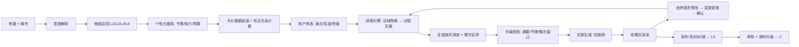

# AI 旅行攻略生成器 · 需求文档 v2.0

| 项目 | 内容 |
|---|---|
| 文档版本 | **v2.0(当前基线)** |
| 上一版本 | v0.4(已归档为历史,不再维护) |
| 文档状态 | 待评审 · 存在 7 个待决策项(第 23 章) |
| 产品形态 | Web 优先,手机 + 桌面浏览器自适应 |
| 项目性质 | 个人作品 / 练手项目,以"先把东西做出来"为第一优先级 |
| 核心命题 | 把「我想去某地玩」到「一份可直接执行的行程」之间的决策成本降到接近零 |
| 代码目录 | `ai-travel-planner/` |
| 配套文档 | `项目决策记录.md`(为什么这么定 + 实测记录)、`需求变更记录.md`(改过什么) |

---

## 0. 相对 v0.4 的变更摘要

v2.0 是一次**信息架构 + 内容维度 + 交互方式**的整体升级,涉及 7 个变更点。

| # | 变更点 | 类型 | 影响面 |
|---|---|---|---|
| 1 | 首页取消国家分组,改混合标签流 + 目的地选择器弹窗 | 信息架构 | 首页重构、数据扩充 |
| 2 | 行程参数改弹窗填写,不再跳页;填写阶段不展示"大家的行程" | 交互 | 首页、路由 |
| 3 | 卡片布局调整(客观信息上移、原声限 3 条)+ 新增详情抽屉 | 展示 | 挑可玩点页 |
| 4 | 可玩点扩展出**住宿**与**吃饭**,并进入排程(按天绑定 + 固定餐次) | **架构级** | 排程引擎、数据模型 |
| 5 | AI 生成过程可视化(真实阶段事件 + SSE 流式) | 工程 | 接口协议、前端 |
| 6 | 新增返回上一页按钮 | 导航 | 全局 Header |
| 7 | 攻略页支持自然语言对话修改行程(AI 出提案、用户确认才生效) | **架构级** | 排程、AI、版本管理 |

**明确保持不变**(v0.4 已确认的决策继续有效):

- 三步闭环:发现 → 选点 → 生成攻略
- 排程「先算后写」:算法产出结构化日程,LLM 只负责措辞
- 来源标记四色体系:官方 / 评论 / 用户反馈 / AI 综合
- 展示层用用户原文,语料层用客观化改写(两层分离)
- UGC 语料升级门禁:≥3 位不同账号确认才可升级
- 一键复刻(原样保留 / 按我的偏好重新生成)
- 账号体系、导出长图、内容广场、审核后台

**一个被撤销的原始需求**:第 3 条曾包含"默认隐藏不好的一面",经复核后**撤销**——缺点全部保留在卡片上。折叠会伤到产品最核心的差异化,先看真实效果再说。

---

## 1. 项目背景与目标

### 1.1 背景

规划一次旅行,用户的真实痛点不是"找不到信息",而是**信息太多、无法收敛**:

- 攻略平台给的是海量碎片内容,需要用户自己拼装成行程;
- 通用大模型能写攻略,但输出是一篇**文章**,不是**可执行的日程**;
- 用户卡住的环节是"这个城市有哪些可玩点、哪些值得去、我 5 天够不够、怎么排不累";
- 已有的行程分享形态(长图、帖子)**无法被复用**,看到好行程只能手动抄一遍;
- 而"住哪、吃哪"这件事,用户要在**玩什么确定之后**再反复调整,现有工具几乎不处理这层耦合。

### 1.2 产品目标

| 层级 | 目标 |
|---|---|
| 用户目标 | 5 分钟内,从一个城市名得到一份按天排好、包含住宿与餐饮、理由明确、可直接照着走的行程 |
| 产品目标 | 跑通闭环,并让"优缺点"这一栏成为产品的记忆点 |
| 社区目标 | 让用户生成的行程可被他人一键复刻,并让用户反馈反哺 AI 语料,形成数据飞轮 |
| **v2.0 新增目标** | 让行程从「一次性产出物」变成「可对话、可修改、可迭代」的对象 |
| 项目目标 | 完成一个可对外展示、可真实使用的作品级产品(不追求首版商业化) |

### 1.3 非目标(明确不做)

- 不做预订(机票、酒店、门票交易链路)
- 不做社交关系链:没有关注、粉丝、私信、个人主页
- 不做图文游记发帖
- 不做行程中的实时导航与天气预警(预留扩展位)
- 首版不做多语言
- **v2.0 不做**:拖拽手动编辑行程、酒店房价与评分的真实数据

---

## 2. 目标用户与核心场景

### 2.1 目标用户

| 用户类型 | 特征 | 核心诉求 |
|---|---|---|
| 主力:自助游规划者 | 20–35 岁,自由行 | 快速得到靠谱的行程骨架 |
| 次主力:多城联游者 | 假期较长,一次去 2–3 个城市 | 城市间时间分配与顺序 |
| 长尾:决策困难者 | 只确定目的地,不知玩什么 | 先被可玩点卡片启发 |
| 行程复用者 | 懒得自己排 | 直接复刻他人成品行程 |
| 内容贡献者 | 刚旅行回来,愿意说两句 | 低成本纠错、补充 |
| **新增:住宿敏感型** | 带父母 / 带娃 / 对住得舒服有要求 | 住宿位置与当日行程的匹配度 |

### 2.2 核心场景(用户故事)

1. **作为** 计划去澳洲玩 8 天的用户,**我希望** 先看到悉尼、墨尔本有哪些可玩点,**以便** 决定每城待几天。
2. **作为** 第一次去东京的用户,**我希望** AI 告诉我每个点的"好处和不好的一面",**以便** 判断值不值得去。
3. **作为** 带父母出行的用户,**我希望** 行程不要太满、不要爬山,**以便** 老人跟得上。
4. **作为** 已经排好行程的用户,**我希望** 导出成长图或链接发给同伴,**以便** 大家对齐安排。
5. **v2.0 新增**:**作为** 临时决定去玩、还没定酒店的用户,**我希望** 先告诉我"住这家的话,去歌剧院和岩石区都是步行 10 分钟",**以便** 我知道住哪最省事。
6. **v2.0 新增**:**作为** 在悉尼要住 5 晚但想中间换一次海边酒店的用户,**我希望** 系统按我那天去哪玩来决定哪几天住哪家,**以便** 不用自己算通勤。
7. **v2.0 新增**:**作为** 等待生成结果的用户,**我希望** 看到 AI 正在做什么,**以便** 知道它没卡死、还要等多久。
8. **v2.0 新增**:**作为** 拿到行程后觉得"第二天太满了"的用户,**我希望** 直接说一句话让它帮我调,**以便** 不用自己找哪里能删。
9. **v2.0 新增**:**作为** 即将出发的用户,**我希望** 问一句"这个行程要注意什么",**以便** 知道要带什么、怎么买票。

---

## 3. 产品定位与价值主张

**一句话定位**:一个把「城市」直接翻译成「含住宿与餐饮的可执行行程」的 AI 旅行规划器,而且这份行程**可以对话修改**。

**五个差异化支点**

| # | 支点 | 说明 |
|---|---|---|
| 1 | **卡片化决策,不是文章阅读** | 每个可玩点是一张可多选的卡,用户在做选择题 |
| 2 | **每个点都敢说缺点** | 明确列出"不好的一面",并标注来源。**v2.0 仍坚持不折叠** |
| 3 | **排程是算出来的** | 时长、通勤、开门时间、体力曲线作为约束参与计算,LLM 不参与排程决策 |
| 4 | **行程可复用** | 别人的行程能一键变成你的,每一次使用与纠错都让 AI 更准 |
| 5 | **v2.0 新增:行程可对话** | 拿到结果后可以继续说人话改它,而且改动必须经你确认 |

---

## 4. 信息架构与全局导航

### 4.1 页面清单

| 路由 | 名称 | 形态 |
|---|---|---|
| `/` | 发现页 | 整页(含两个弹窗) |
| `/city/{cityId}` | 挑可玩点 | 整页(参数经 query 传入) |
| `/trip/{tripId}` | 攻略页 | 整页(含详情抽屉、对话输入框) |
| `/s/{slug}` | 公开分享页 | 整页(只读,未登录可访问) |
| `/plaza` | 内容广场 | 整页 |
| `/my` | 我的攻略 | 整页 |
| `/login` | 登录 | 整页 |
| `/admin` | 审核后台 | 整页(非 admin 返回 404) |

**弹窗类(不产生路由)**

| 弹窗 | 触发 |
|---|---|
| 目的地选择器 | 发现页「查看更多」 |
| 行程参数 | 发现页点击任一城市标签 / 选择器内选中城市 |
| 可玩点详情抽屉 | 挑可玩点页卡片「查看详情」 |

### 4.2 全局返回按钮(★ 变更 6)

| 项 | 规格 |
|---|---|
| 位置 | Header **左侧**,图标 + 「返回」文字(移动端仅图标) |
| 显示条件 | 非首页时显示 |
| 行为 | 优先 `router.back()`;若无可返回历史(直接打开链接),按兜底映射跳转 |
| 兜底映射 | `/city/*` → `/`;`/trip/*` → `/my`;`/s/*` → `/plaza`;`/my`、`/plaza`、`/login` → `/` |
| 与面包屑关系 | 两者**并存**:返回按钮负责"上一级操作",面包屑负责"我在哪" |
| 无障碍 | 点击热区 ≥ 44×44px;`aria-label="返回上一页"` |

### 4.3 全局状态提示

任何 AI 生成过程都必须有可见状态(见第 12 章),任何失败都必须**显式告知**并提供重试,**不允许静默降级**为本地内容而不提示。

---

## 5. 页面一:发现页(★ 变更 1)

### 5.1 页面结构

```
┌──────────────────────────────────────────────────────────┐
│ Header: [← 返回]  AI 旅行攻略生成器      [大家的行程][登录] │
├──────────────────────────────────────────────────────────┤
│  Hero 标题 + 一句话价值主张 + 数据概览                       │
│                                                          │
│  [ 国外 ] [ 国内 ]        ← 分段控件,默认「国外」            │
│                                                          │
│  混合标签流(单行流式排列,不分区、不换行分组)                 │
│  ┌──────────────────────────────────────────────────┐    │
│  │ #1 🌉悉尼  #2 🐼成都  #3 🗼东京  🎨墨尔本  🛕曼谷   │    │
│  │ 🏔️皇后镇  🗼巴黎  …(共 20 个)…      [ 查看更多 → ]│    │
│  └──────────────────────────────────────────────────┘    │
│                                                          │
│  大家的行程(保留在此页底部)                                │
│  三步就能出发(保留)                                       │
└──────────────────────────────────────────────────────────┘
```

### 5.2 混合标签流规格

| 项 | 规格 |
|---|---|
| 总展示数 | **20 个地点标签** + 1 个「查看更多」按钮 |
| 去重 | 热门 Top5 属于这 20 个之内,不重复占位 |
| 排序 | 按热度分降序;Top5 按 `hot_rankings` 的 rank 排在**最前** |
| 换行 | 流式排列,自然换行;不做"热门区/全量区"的分组与分隔线 |
| 热门样式 | 品牌色底 + `#N` 排名 + 城市 icon,视觉权重高于普通标签 |
| 普通样式 | 白底描边 + icon + 城市名 |
| 无内容城市 | 标签后缀灰字「筹备中」,点击后照常打开参数弹窗,并在弹窗内提示"该城市内容筹备中" |
| 「查看更多」 | 虚线边框 + `→` 图标,位置固定在第 21 位 |
| 响应式 | 桌面端单行尽量铺满;移动端 `flex-wrap`,标签高度统一 |

### 5.3 交互需求

| 编号 | 需求 | 优先级 |
|---|---|---|
| F5-01 | 点击热门 / 普通城市标签 → **原地打开行程参数弹窗**(不跳页) | P0 |
| F5-02 | 点击「查看更多」→ 打开目的地选择器弹窗 | P0 |
| F5-03 | 国内 / 国外切换时标签流即时重排,不刷新整页 | P0 |
| F5-04 | 无内容城市在参数弹窗内给出明确提示与推荐替代 | P0 |
| F5-05 | 标签 hover / active 微动效,点击反馈 ≤ 100ms | P1 |
| F5-06 | 标签流首屏数据走缓存,首屏可交互 ≤ 2s | P0 |
| F5-07 | 空间不足时「查看更多」始终可见(可换到下一行) | P0 |

### 5.4 数据要求

城市目录从 9 个扩充到 **28 个**(国外 16 / 国内 12),详见附录 A。其中**有 POI 内容的仍只有 悉尼 / 墨尔本 / 成都**。

> **排布克制原则**:27 个城市没有内容,首页会出现大量"筹备中"标签,视觉上会显得空。因此标签流中**优先排有内容的城市**,再按热度补足到 20 个。不要为了凑数把冷门且无内容的城市排进来。

---

## 6. 目的地选择器弹窗(★ 变更 1)

### 6.1 层级结构

| 层级 | 国外 | 国内 |
|---|---|---|
| **第一层** | **洲**:亚洲 / 欧洲 / 非洲 / 北美洲 / 南美洲 / 大洋洲 | **省份 / 直辖市** |
| **第二层** | 该洲下的城市列表 | 该省下的城市列表 |

> 国外按洲、国内按省份,是因为国内没有与"洲"对等的行政层级。两层结构在视觉与交互上保持一致,用户不需要学两套。

### 6.2 第一层:分类宫格

```
┌─────────────────────────────────────┐
│  选择目的地                     [×]  │
│  [ 国外 ] [ 国内 ]                   │
│                                     │
│  ┌────────┐ ┌────────┐ ┌────────┐  │
│  │ 亚洲   │ │ 欧洲   │ │ 非洲   │  │
│  │  8 个  │ │  3 个  │ │  0 个  │  │
│  └────────┘ └────────┘ └────────┘  │
│  ┌────────┐ ┌────────┐ ┌────────┐  │
│  │北美洲  │ │南美洲  │ │大洋洲  │  │
│  │  2 个  │ │  0 个  │ │  3 个  │  │
│  └────────┘ └────────┘ └────────┘  │
└─────────────────────────────────────┘
```

| 规则 | 说明 |
|---|---|
| 数量为 0 的分类 | 置灰不可点,显示「暂未收录」 |
| 每个分类 | 显示名称 + 已收录城市数 |
| 国内第一层 | 同样的宫格,内容为省份/直辖市 |

### 6.3 第二层:城市列表

```
┌─────────────────────────────────────┐
│  [← 亚洲]  选择目的地            [×] │
│                                     │
│  ┌──────────────────────────────┐  │
│  │ 🗼 东京            日本  ●有内容│  │
│  │ 🏯 大阪            日本         │  │
│  │ 🛕 曼谷            泰国  ●有内容│  │
│  │ 🏝 普吉岛          泰国         │  │
│  │ 🦁 新加坡          新加坡       │  │
│  │ 🌴 巴厘岛          印度尼西亚   │  │
│  │ 🕌 迪拜            阿联酋       │  │
│  └──────────────────────────────┘  │
└─────────────────────────────────────┘
```

| 编号 | 需求 | 优先级 |
|---|---|---|
| F6-01 | 点城市 → **关闭选择弹窗 → 立即打开该城市的行程参数弹窗**(单选直达) | P0 |
| F6-02 | 城市行显示:icon + 城市名 + 所属国家/省份 + 「有内容」标记 | P0 |
| F6-03 | 顶部提供「← 返回分类」回到第一层 | P0 |
| F6-04 | 无内容城市可点,进入参数弹窗后提示"筹备中" | P0 |
| F6-05 | 支持滚动;城市数量多时按热度排序 | P0 |
| F6-06 | 搜索框(输入城市名直接定位) | P1 |
| F6-07 | 记住上次查看的 Tab(国内/国外) | P2 |

### 6.4 交互细节

| 项 | 规格 |
|---|---|
| 形态 | 居中模态,桌面端最大宽 640px;移动端全屏 sheet |
| 关闭 | ESC / 点遮罩 / 右上角 ×;关闭不产生路由历史 |
| 层级切换 | 第二层内部切换有 200ms 左右的横向滑动过渡 |
| 滚动锁定 | 弹窗打开时锁定 body 滚动 |

---

## 7. 行程参数弹窗(★ 变更 2)

### 7.1 规格

| 项 | 规格 |
|---|---|
| 触发 | 发现页点击任一城市标签 / 选择器内选中城市 |
| 形态 | 居中模态,桌面端最大宽 560px;移动端全屏 sheet |
| **不包含** | **「大家的行程」不在此阶段展示**(明确要求) |
| 关闭 | ESC / 点遮罩 / 取消按钮;关闭不产生路由历史 |

### 7.2 内容

```
┌───────────────────────────────────────┐
│  悉尼                          [×]    │
│  海港、歌剧院与海滩,澳洲最经典的第一站   │
│                                       │
│  先说一下这趟怎么玩                    │
│  这些信息用来裁剪可玩点列表 —— 比如带父母 │
│  就不会把高强度徒步排在前面。除天数外都   │
│  可以跳过。                            │
│                                       │
│  玩几天 *      [2][3][4][5][7][10] [__]│
│  从哪出发      [____________]          │
│  预算档位      [穷游][标准][舒适][奢华] │
│  和谁一起      [单人][情侣][朋友][亲子][带父母]│
│  节奏          [松弛][标准][特种兵]     │
│                                       │
│  该城市已上线 19 个可玩点               │
│                    [取消]  [下一步:挑可玩点]│
└───────────────────────────────────────┘
```

| 字段 | 必填 | 默认值 | 说明 |
|---|---|---|---|
| 天数 | 是 | — | 快捷选项 2/3/4/5/7/10 + 自定义 1–30 |
| 出发地 | 否 | 空 | 用于估算到达日 |
| 预算档位 | 否 | 标准 | 穷游 / 标准 / 舒适 / 奢华 |
| 同行人 | 否 | 朋友 | 单人 / 情侣 / 朋友 / 亲子 / 带父母 |
| 节奏 | 否 | 标准 | 松弛 2–3 / 标准 3–4 / 特种兵 5–6 点/天 |

### 7.3 交互需求

| 编号 | 需求 | 优先级 |
|---|---|---|
| F7-01 | 打开弹窗时聚焦到天数控件,支持键盘操作 | P1 |
| F7-02 | 提交 → 关闭弹窗 → 跳转 `/city/{id}?days=..&origin=..&budget=..&companion=..&pace=..` | P0 |
| F7-03 | 参数经 **URL query** 传递,刷新不丢、可分享、可回退 | P0 |
| F7-04 | 目标页面挂载后自动发起可玩点生成,并展示 AI 过程(第 12 章) | P0 |
| F7-05 | 无内容城市:参数区照常可用,下方提示"内容筹备中,可先看看 悉尼/墨尔本/成都" | P0 |
| F7-06 | 未登录用户可正常填参数;在"生成攻略"时再引导登录 | P0 |

---

## 8. 页面二:挑可玩点(★ 变更 3、4)

### 8.1 页面结构

```
┌──────────────────────────────────────────────────────────┐
│ [← 返回]  悉尼 · 挑可玩点                                  │
│ 已按你的节奏与同行人从 19 个点位中优先挑出 16 个 ·           │
│ 带父母 / 标准 / 标准预算 / 4 天        [改参数] [重新生成]  │
│                                                          │
│ [全部] [景点] [住宿] [吃饭] [体验] [自然] [购物]  ← 类别 Tab │
│                                                          │
│  ┌────────┐ ┌────────┐ ┌────────┐                        │
│  │ 卡片   │ │ 卡片   │ │ 卡片   │  ← 响应式网格          │
│  └────────┘ └────────┘ └────────┘                        │
│                                                          │
│ ─────────────────────────────────────────────────────── │
│ 已选 5 个 · 约需 2.5 天 | 4 天建议不超过 12 个  [帮我挑到刚好] [生成攻略(5)]│
└──────────────────────────────────────────────────────────┘
```

### 8.2 类别 Tab(★ 变更 4)

| Tab | 对应 `category` | 说明 |
|---|---|---|
| 全部 | — | 默认,混排 |
| 景点 | `sight` | |
| **住宿** | `stay` | **★新增** |
| **吃饭** | `food` | 原"美食",语义扩为餐饮点 |
| 体验 | `experience` | |
| 自然 | `nature` | |
| 购物 | `shopping` | |

- Tab 上显示该类目候选数量,数量为 0 的 Tab 置灰
- 切换 Tab 不丢失已选状态;已选数量常驻底部
- **住宿 Tab 需在 Tab 名旁显示辅助提示**「选了好帮你把每天行程串起来」,降低用户"为什么要选酒店"的困惑

### 8.3 卡片布局(★ 变更 3)

**新顺序**(客观信息上移,原声限 3 条):

| 序 | 区块 | 变化说明 |
|---|---|---|
| 1 | 头图位(区域 · 类别 + 选中按钮) | 不变;无图时显示占位 |
| 2 | 名称(中文 + 原文名) | 不变 |
| 3 | 一句话简介(≤ 40 字) | 不变 |
| 4 | ✅ **好处**(2–3 条,每条带来源标记) | 不变 |
| 5 | ⚠️ **不好的一面**(1–3 条,每条带来源标记) | **保留,不折叠** |
| 6 | **📋 客观信息行**:建议停留时长 · 开放时间 · 门票 · 体力 | **★ 上移**(原在"去过的人说"下方) |
| 7 | 💬 **去过的人说** | **★ 最多 3 条**;超出显示「查看全部 N 条 →」 |
| 8 | 操作区:[查看详情] [我也说一句] | **★ 新增详情按钮** |

**住宿 / 餐饮卡片的额外区块**(见 8.5):在区块 6 之后插入「🚶 邻近关系」行。

### 8.4 详情抽屉(★ 变更 3)

| 项 | 规格 |
|---|---|
| 触发 | 卡片「查看详情」/「查看全部 N 条」 |
| 桌面端 | 从**右侧**滑出,宽 480–560px,遮罩半透明 |
| 移动端 | 从**底部**弹出,高度 88vh,可下滑关闭 |
| 关闭 | ESC / 点遮罩 / 右上角 × / 移动端下滑 |

**抽屉内容(全部)**

| 区块 | 内容 |
|---|---|
| 图片位 | 大图占位(接入图库 API 后为轮播) |
| 基本信息 | 名称、原文名、区域、类别、适合人群、体力 |
| ✅ 全部好处 | 不限条数,含每条来源标记与来源详情(hover 可见) |
| ⚠️ 全部不好的一面 | 不限条数,同上 |
| 📋 完整客观信息 | 开放时间、门票、更新日期;若为 AI 种子数据,显示「⚠ 待核实」警示 |
| **🚶 邻近关系** | 到最近 3 个游玩点的通勤方式与耗时(住宿/餐饮必显示) |
| 💬 全部用户原声 | 按 👍 值得去 / 👎 要避坑 / 📌 事实补充**三组分别展示**,不限条数,含昵称、时间、确认数 |
| 操作区 | [选中 / 取消] [我也说一句] [这条不对] |

| 编号 | 需求 | 优先级 |
|---|---|---|
| F8-01 | 抽屉内操作与卡片状态**双向同步**(抽屉里选中,卡片立即反映) | P0 |
| F8-02 | 抽屉内可提交短评,提交后原声列表刷新 | P0 |
| F8-03 | 抽屉打开时锁定页面滚动 | P0 |
| F8-04 | 抽屉内滚动位置独立,关闭时重置 | P1 |
| F8-05 | 支持键盘 `←` `→` 在同类目内切换上一个/下一个点位 | P2 |

### 8.5 住宿与餐饮的展示规格(★ 变更 4)

#### 8.5.1 邻近关系必须显示(明确要求)

每个住宿 / 餐饮候选卡片与抽屉,**必须**展示到邻近游玩点的通勤关系:

```
🏨 悉尼港景酒店
🚶 步行 8 分钟 → 悉尼歌剧院
🚶 步行 12 分钟 → 岩石区
🚇 公交 15 分钟 → 达令港
```

| 规则 | 说明 |
|---|---|
| 数量 | 最多 3 个,按距离升序 |
| 计算 | 服务端按 haversine 计算该点与**同城游玩点(`sight`/`nature`/`experience`)**的直线距离,乘 1.3 绕行系数后换算通勤方式与耗时(沿用排程引擎的估算函数) |
| 展示 | 步行(≤1.2km)/ 公共交通(≤15km)/ 打车 |
| 落库 | **不落库**,动态计算(数据量小,避免同步问题) |

#### 8.5.2 住宿卡片附加信息

| 信息 | 说明 |
|---|---|
| 住宿档次 | 复用 `ticket_level` 语义为价位档(节省 / 标准 / 舒适 / 高) |
| 区域 | 必填,参与按天匹配 |
| 可选标记 | 「多选后系统按天分配」的说明文案 |

#### 8.5.3 餐饮卡片附加信息

| 信息 | 说明 |
|---|---|
| 适用餐次 | 午餐 / 晚餐 / 两者皆可(新字段 `meal_type`) |
| 人均价位档 | 复用 `ticket_level` |

#### 8.5.4 住宿与餐饮的优缺点体系

**同等适用**:住宿与餐饮同样必须有「好处」与「不好的一面」,并带四色来源标记。理由:这是产品的记忆点,新增类别不能打折。例如酒店必须有"位置极佳但房间偏小""临街夜间有噪音"这类真实代价。

### 8.6 其他交互需求

| 编号 | 需求 | 优先级 |
|---|---|---|
| F8-06 | 底部常驻选择栏:已选数量、约需天数、节奏建议上限 | P0 |
| F8-07 | 超量告警:"选多了,N 天排不下这么密" | P0 |
| F8-08 | 「帮我挑到刚好」一键按容量勾选 | P0 |
| F8-09 | 卡片标记"已被 N 个行程采用" | P1 |
| F8-10 | 生成中的等待体验:切换为 AI 过程可视化(第 12 章) | P0 |
| F8-11 | 页面底部保留「大家的悉尼行程」区块 | P1 |

---

## 9. 页面三:攻略页(★ 变更 4、7)

### 9.1 页面结构

```
┌──────────────────────────────────────────────────────────┐
│ [← 返回]  带父母悉尼三日:海港慢行线                          │
│ 悉尼 · 3 天 · 标准节奏 · 带父母 · 标准预算                  │
│ 改编自 @Nina 的《悉尼 + 墨尔本 8 天》(若为复刻)              │
│                                                          │
│ 行程概述文案…                                             │
│ [⚠ 排程告警区]                                            │
│                                                          │
│ 第 1 天 · 悉尼 · 环形码头(强度 轻松)                       │
│   当天小结…                                               │
│   🏨 住宿:悉尼港景酒店(连住第 1–2 晚)                      │
│   🌅 上午:抵达 / 酒店休整                                  │
│   ☀️ 下午:悉尼歌剧院(135min)                              │
│   🌙 晚上:晚餐 → 岩石区小酒馆(60min)                       │
│   💡 提示…                                               │
│ …                                                        │
│                                                          │
│ 出行提醒 …                                               │
│                                                          │
│ ┌──────────────────────────────────────────────────┐     │
│ │ 💬 想改行程?直接说 —— 例如"第二天太满了,把博物馆挪到第三天"│     │
│ │ [___________________________________] [发送]       │     │
│ └──────────────────────────────────────────────────┘     │
│ [发布到广场][复制链接][导出长图][♥ 12][一键复刻]              │
└──────────────────────────────────────────────────────────┘
```

### 9.2 行程展示规格(★ 变更 4)

| 区块 | 内容 | 变化 |
|---|---|---|
| 行程概览 | 总天数、城市分配、节奏、预算、总预算估算 | 不变 |
| 逐日卡片 | 第 N 天 · 城市 · 区域 · 强度 | 不变 |
| **🏨 住宿行** | 当天住宿名称 + 连住晚数;换酒店日额外标注「换酒店」 | **★ 新增** |
| 时段块 | 上午 / 下午 / 晚上;含停留时长与通勤方式耗时 | 不变 |
| **餐次** | 午餐、晚餐作为固定安排在对应时段内展示,样式与景点区分 | **★ 新增** |
| 每日小结 | LLM 生成的一句话主基调 | 不变 |
| 每日提示 | 一条可执行提醒 | 不变 |
| 出行提醒 | 2–3 条通用提醒 | 不变 |

**视觉区分规则**

| 类型 | 视觉 |
|---|---|
| 游玩点 | 实心圆点 + 常规字重 |
| 住宿 | 🏨 图标 + 浅色底块 |
| 餐饮 | 🍽 图标 + 浅色底块 |
| 占位安排(抵达/返程/自由活动) | 空心圆点 + 灰色字 |

### 9.3 住宿按天绑定的展示逻辑(★ 变更 4 核心)

| 场景 | 展示 |
|---|---|
| 连住多晚 | 「🏨 悉尼港景酒店(连住第 1–2 晚)」,只在入住日标注 |
| 换酒店日 | 「🏨 **换酒店**:退房 → 寄存行李 → 入住 邦迪海滩酒店(约 90 分钟)」,当日强度自动下调 |
| 未选住宿 | 「🏨 **住宿建议**(未选定):A / B / C,均在当天区域步行 15 分钟内」+「去挑住宿 →」入口 |

### 9.4 攻略页操作区(沿用 + 扩展)

| 操作 | 说明 |
|---|---|
| 发布到广场 / 取消公开 | 沿用 |
| 复制分享链接 | 沿用 |
| 导出长图 | 沿用 |
| 点赞 / 被复刻次数 | 沿用 |
| **一键复刻** | 沿用(原样保留 / 按我的偏好重新生成) |
| 重命名 / 删除 | 沿用 |
| **回滚到上一版本** | **★ 新增**(有修订记录时显示) |

---

## 10. AI 过程可视化(★ 变更 5)

### 10.1 目标

在用户等待生成结果时,**用真实进度替代干等**,降低等待焦虑。适用于两个阶段:可玩点生成、行程生成。

### 10.2 技术方案

**同一 POST 请求内 SSE 流式返回**。前端用 `fetch` + `ReadableStream` 读取事件流,先收阶段事件,最后收结果。

| 项 | 规格 |
|---|---|
| 协议 | `text/event-stream`,事件类型 `step` / `result` / `error` |
| 状态存储 | **不需要**。事件与结果都在同一请求的生命周期内,不引入 taskId 与任务表 |
| 断连处理 | 连接中断 → 自动降级为轮询结果接口(带同一 `requestId`) |
| 超时 | 90 秒无新事件 → 前端显示「仍在处理,请稍候」,连接保持 |
| 心跳 | 每 15 秒发一次 `: ping` 注释行,防中间层断连 |

### 10.3 可玩点生成阶段事件

| code | 文案模板 |
|---|---|
| S1 | 正在解析你的行程条件(5 天 / 标准节奏 / 带父母) |
| S2 | 已召回该城市 19 个候选点位 |
| S3 | 按节奏与同行人裁剪,保留 16 个 |
| S4 | 载入已有用户反馈与评论归纳(3 条) |
| S5 | 正在生成文案(第 1/2 批,共 16 个点位) |
| S6 | 写入语料库并校验来源标记 |
| S7 | 完成 |

### 10.4 行程生成阶段事件

| code | 文案模板 |
|---|---|
| T1 | 正在解析已选点位(共 9 个) |
| T2 | 按区域聚类,分成 3 个区域 |
| T3 | 分配到 3 天并校验通勤上限 |
| T4 | 校验节奏上限与到达 / 离开日折算 |
| T5 | 正在安排住宿与餐次 |
| T6 | 正在生成每日文案与提醒 |
| T7 | 落库并生成分享链接 |

### 10.5 前端组件 `AiProgressFeed`

| 项 | 规格 |
|---|---|
| 形态 | 时间线式滚动列表;最新一步高亮,历史步骤打勾置灰 |
| 自动滚动 | 新事件到达时滚到底;**用户手动上滑后暂停自动滚动**,松手回到顶部 4 秒后恢复 |
| 进度条 | 顶部细进度条,由事件的 `progress` 字段驱动(非线性,反映真实耗时占比) |
| 兜底 | 超过 90 秒无事件 → 显示「仍在处理,请稍候」 |
| 失败 | 收到 `error` → 展示原因 + 「重试」按钮,**不得静默降级** |
| 位置 | 可玩点页与攻略页共用同一组件 |

### 10.6 明确不做

**不展示模型内部 reasoning 原文**。只展示真实业务阶段。理由:思考内容有噪音、可能包含不成熟推断、会误导用户,且属于内部实现细节。

---

## 11. 行程自然语言修改(★ 变更 7)

### 11.1 核心原则

> **AI 不直接改日程,只输出结构化变更指令;排程引擎校验后应用,用户确认后才生效。**

这与 v0.4 的「先算后写」一脉相承:LLM 负责理解人话与生成指令,是否可行由算法判定。

### 11.2 交互流程

```
用户输入自然语言
   ↓
POST /api/trips/{id}/chat
   ↓ LLM 解析意图 → 输出 变更提案 JSON 或 纯问答回答
   ↓
┌─ kind = "answer" ─────────────────────────────┐
│ 💬 直接以对话气泡回复文字,不改行程                │
└──────────────────────────────────────────────┘
┌─ kind = "proposal" ───────────────────────────┐
│ 我打算这样改(3 处):                            │
│  · 移除 第 2 天:澳大利亚博物馆                    │
│  · 新增 第 3 天:澳大利亚博物馆                    │
│  · 替换住宿:邦迪海滩酒店(距邦迪海滩步行 5 min)     │
│ ⚠ 提醒:第 3 天强度将由「标准」变为「较满」          │
│ [应用变更]  [取消]                             │
└──────────────────────────────────────────────┘
   ↓ 点「应用变更」
POST /api/trips/{id}/apply
   ↓ 排程引擎重跑 + 文案重生成
   ↓ 就地更新行程 + 写一条修订记录
行程更新,页面顶部提示「已应用变更 · 查看改动 · 撤销」
```

### 11.3 意图类型

| 意图 | 说明 | 是否改行程 |
|---|---|---|
| `add_poi` | 增加点位(可指定某天) | 是 |
| `remove_poi` | 删除点位 | 是 |
| `replace_poi` | 替换点位 | 是 |
| `move_poi` | 移动点位到另一天 | 是 |
| `change_lodging` | 替换 / 指定某天住宿 | 是 |
| `add_meal` / `change_meal` | 餐饮调整 | 是 |
| `adjust_pace` | 调整节奏 | 是 |
| `adjust_days` | 调整天数 | 是 |
| `ask` | 纯问答 | **否** |

### 11.4 纯问答必须能回答的内容

| 类别 | 示例 |
|---|---|
| 着装与准备 | "需要带什么衣服""现在这个季节要带伞吗" |
| 交通与支付 | "交通卡怎么买""能刷卡吗""要不要带现金" |
| 预约与开放 | "哪些要提前预约""周一有闭馆的吗" |
| 体力与节奏 | "带父母这个节奏能撑住吗" |
| 礼仪与安全 | "小费怎么给""晚上安全吗" |

> **回答约束**:与生成链路同一套规则 —— 不得编造具体价格、时刻、班次;不确定就说明不确定并建议出行前确认。

### 11.5 功能需求

| 编号 | 需求 | 优先级 |
|---|---|---|
| F11-01 | 攻略页底部常驻自然语言输入框(可折叠) | P0 |
| F11-02 | 支持多轮对话;对话历史在当前会话内保留 | P0 |
| F11-03 | 变更提案以卡片形式展示,列出逐条差异 | P0 |
| F11-04 | 应用变更后**就地更新**行程,页面不整页刷新 | P0 |
| F11-05 | 应用后顶部提示「已应用变更 · 查看改动 · 撤销」 | P0 |
| F11-06 | 变更后重新排程,若导致点位排不下,必须在提案阶段就预警 | P0 |
| F11-07 | 修订记录:每次应用写一条 `trip_revisions` | P0 |
| F11-08 | 支持回滚到任意历史版本 | P1 |
| F11-09 | 支持「在行程的某个位置进行编辑」:点位行内提供替换 / 移除入口 | P0 |
| F11-10 | 对话输入支持快捷建议("第二天太满了""换一家住宿") | P1 |
| F11-11 | 对话限流:每分钟 ≤ 6 次 | P0 |

### 11.6 明确不做(v2.1 再议)

- 拖拽调整行程顺序
- 手动增删点位的完整表单(仅提供行内「替换 / 移除」)
- 多人协同编辑

---

## 12. 账号 / 收藏 / 导出分享

沿用 v0.4,无变更。要点:

| 功能 | 说明 |
|---|---|
| 登录 | 邮箱免密;内置 `demo@local.dev` / `admin@local.dev` |
| 我的攻略 | 列表、重命名、删除 |
| 心愿单 | 收藏单个可玩点(P1) |
| 导出长图 | html-to-image(F5-01) |
| 分享链接 | `/s/{slug}` 只读页,未登录可访问,底部提供一键复刻 |
| 内容广场 | `/plaza`,筛选 + 排序,不做关注流 |
| 一键复刻 | 原样保留 / 按我的偏好重新生成 |

---

## 13. UGC 与审核后台

沿用 v0.4 全部门禁与流程,补充一点:

- **住宿与餐饮的用户短评同等适用**:机审 → AI 意向判定 → 人工审核 → 交叉验证 → 升级语料。酒店与餐厅的真实反馈价值可能高于景点(踩坑成本更高)。

审核后台保持不变:四队列(贡献 / 图片 / 升级确认 / 举报),非 admin 访问返回 404。

---

## 14. 数据与 AI 架构

### 14.1 数据分层(在 v0.4 基础上新增)

| 层 | 内容 | 变化 |
|---|---|---|
| L1 人工校准库 | 城市、POI 基础信息、时长、体力、适合人群 | 扩充 `stay` 类 |
| L2 客观事实 | 门票、开放时间、地址 | **住宿/餐饮暂不接入**(房价与评分不真实,见第 22 章风险) |
| L3 主观评价 | 优缺点条目、评论归纳、升级后的用户语料 | 不变 |
| L4 热度数据 | 城市榜、POI 热门度 | 不变 |
| L5 图片 | POI 主图 | 不变 |
| L6 用户内容 | 公开行程、短评、投票 | 新增住宿/餐饮短评 |
| L7 审核与审计 | 审核状态、处理日志 | 不变 |
| **L8 行程修订** | 变更提案、前后快照、版本号 | **★ 新增** |

### 14.2 生成链路(更新)



### 14.3 关键工程约束(在 v0.4 基础上新增)

1. 所有 AI 输出必须是结构化 JSON
2. 客观事实不得由 LLM 生成
3. 用户内容不得直接进入生成上下文
4. **★ 新增:AI 不得直接修改日程**。它只能输出变更指令,由排程引擎校验后应用
5. **★ 新增:住宿与餐饮不进入"客观信息"体系**,只展示区域与邻近关系(房价/评分不真实)

---

## 15. 排程引擎规格(★ 变更 4 核心)

### 15.1 硬约束(在 v0.4 基础上扩展)

| 约束 | 规则 | 变化 |
|---|---|---|
| 每日点位数量 | 松弛 2–3 / 标准 3–4 / 特种兵 5–6 | 沿用 |
| 单日通勤上限 | ≤ 90 分钟 | 沿用 |
| 地理聚类 | 同一天点位落在同一区域 | 沿用 |
| 用餐时段保留 | 午 90 / 晚 60 分钟 | 沿用 |
| 到达 / 离开日折算 | 按 0.5 天 | 沿用 |
| 开放时间窗口 | 有数据的 POI 落在开放时间内 | 沿用 |
| 预算约束 | 门票 + 交通不超预算档 | 沿用 |
| **住宿锚点** | 当天第一个行程从住宿点出发,最后一个回到住宿点 | **★ 新增** |
| **住宿邻近上限** | 住宿到当天任一游玩点的单程通勤 ≤ 30 分钟 | **★ 新增** |
| **换酒店日** | 当日游览预算 × 0.75,并插入 60–90 分钟搬运安排 | **★ 新增** |
| **餐次窗口** | 午餐落在 12:00–13:30,晚餐落在 18:30–20:00 | **★ 新增** |
| **餐饮邻近** | 餐饮点到所在时段前后点位的单程通勤 ≤ 20 分钟 | **★ 新增** |

### 15.2 住宿按天绑定算法

```
输入:用户多选的酒店集合 H(≤5)、每日游玩点分区结果 D1..Dn

1. 对每一天 Di,计算 H 中每家酒店的匹配成本:
     cost(h, Di) = 到 Di 内各游玩点的通勤时间之和
2. 贪心 + 局部优化:
     先按第一天选最优;之后每天在"换酒店成本(90 分钟)"与"通勤节省"之间做权衡
     仅当 Σ 通勤节省 > 换酒店成本 × 1.5 时才换(避免频繁搬家)
3. 约束校验:每天选中的酒店必须满足"到当天任一游玩点 ≤ 30 分钟"
     若都不满足,放宽到最近的一家并在告警中说明
4. 输出:每天绑定一家酒店 + 是否为换酒店日
```

**未选住宿时**:跳过步骤 1–4,输出「住宿建议」区块(按当天区域就近推荐 2–3 家并标注未选定)。

### 15.3 餐次安排算法

```
对每一天:
  午餐:在 12:00–13:30 窗口内,选距离"上午最后一个点"与"下午第一个点"加权最近的餐饮点
  晚餐:在 18:30–20:00 窗口内,优先选住宿附近,其次选当日区域内的餐饮点
  约束:餐饮点不参与"每日点位数量"上限计数(它们是固定安排,不是可玩点)
  未选餐饮时:用同区域 AI 推荐补位并标注「建议」
```

### 15.4 输出结构变更

`TripDay` 新增字段:

```ts
interface TripDay {
  // …沿用字段
  lodging: {
    poiId: string | null;
    name: string;
    isChangeover: boolean;   // 是否为换酒店日
    nightsStayed: number;    // 连住晚数(仅在入住日标注)
    isSuggested: boolean;    // 是否为系统建议(用户未选)
  } | null;
  meals: Array<{
    type: "lunch" | "dinner";
    poiId: string | null;
    name: string;
    isSuggested: boolean;
  }>;
}
```

---

## 16. 数据模型变更清单

| 表 | 变更 | 说明 |
|---|---|---|
| `countries` | **新增** `continent` | 洲:亚洲 / 欧洲 / 非洲 / 北美洲 / 南美洲 / 大洋洲 |
| `cities` | **新增** `province` | 省 / 直辖市,用于国内分类 |
| `pois` | `category` 枚举**新增** `stay` | 住宿 |
| `pois` | **新增** `meal_type` | 餐饮适用餐次:`lunch` / `dinner` / `both`,可空 |
| `trips` | **新增** `version` | 整数,默认 1 |
| `trip_revisions` | **新增表** | `id / trip_id / version / proposal_json / schedule_before / schedule_after / params_before / params_after / created_by / created_at` |
| `llm_usage_logs` | `task` 取值扩展 | 新增 `trip_chat` / `trip_propose` |
| `countries` / `cities` | 数据扩充 | 城市 9 → 28(附录 A) |

**不新增的表**

- `poi_nearby`:邻近关系动态计算,避免同步问题
- SSE 事件表:事件在请求生命周期内,不落库

---

## 17. 接口清单

| 接口 | 方法 | 变更 |
|---|---|---|
| `/api/auth/login` | POST | 沿用 |
| `/api/auth/logout` | POST | 沿用 |
| `/api/cities` | GET | **新增**:`?scope=&limit=20`,返回混合标签流(含热门标记与 rank) |
| `/api/cities/groups` | GET | **新增**:`?scope=`,返回分类宫格数据(国外→洲 / 国内→省)+ 各组城市 |
| `/api/cards` | POST | **改为 SSE**:先推 S1–S7 阶段事件,最后推 `result` |
| `/api/plan` | POST | **改为 SSE**:先推 T1–T7 阶段事件,最后推 `result` |
| `/api/trips/{id}` | POST | 扩展 `action`:新增 `revert`(回滚到指定版本) |
| `/api/trips/{id}/chat` | POST | **新增**:返回 `{ kind: "answer" \| "proposal", ... }` |
| `/api/trips/{id}/apply` | POST | **新增**:应用变更提案,重跑排程,写修订记录 |
| `/api/ugc` | POST | 沿用(submit / vote / report) |
| `/api/admin` | POST | 沿用 |

### SSE 事件格式

```
event: step
data: {"seq":3,"code":"S3","text":"按节奏与同行人裁剪,保留 16 个","detail":"带父母 → 高强度点位降权","progress":0.42}

event: result
data: {"ok":true,"cards":[…],"meta":{"mode":"live","model":"deepseek-v4-flash","cached":false,"latencyMs":21500,"costCny":0.022}}

event: error
data: {"ok":false,"error":"输出预算耗尽(finish_reason=length)","retryable":true}

: ping
```

### 变更提案 Schema

```json
{
  "kind": "proposal",
  "summary": "我打算这样改(3 处)",
  "changes": [
    { "op": "remove_poi", "dayIndex": 2, "poiId": "syd_xxx", "label": "移除 第 2 天:澳大利亚博物馆" },
    { "op": "add_poi", "dayIndex": 3, "poiId": "syd_xxx", "label": "新增 第 3 天:澳大利亚博物馆" },
    { "op": "change_lodging", "dayIndex": 2, "poiId": "syd_bondi_hotel", "label": "替换住宿:邦迪海滩酒店" }
  ],
  "warnings": ["第 3 天强度将由「标准」变为「较满」"],
  "nextParams": { "days": 3, "pace": "standard", "poiIds": ["…"], "lodgingIds": ["…"] }
}
```

---

## 18. 非功能需求

| 类别 | 要求 | 变化 |
|---|---|---|
| 响应式 | 移动端优先,断点 375 / 768 / 1280 | 沿用 |
| 性能 | 首屏可交互 ≤ 2s(4G) | 沿用 |
| 生成耗时 | 可玩点 P90 ≤ 8s;完整攻略 P90 ≤ 20s | 沿用 |
| **SSE 断连** | 连接中断自动降级为轮询;心跳 15s;90s 无事件提示"仍在处理" | **★ 新增** |
| **抽屉性能** | 打开动画 ≥ 45fps;抽屉内列表虚拟化不做(条数有限) | **★ 新增** |
| 成功率 | AI 生成成功率 ≥ 98%,失败必须显式告知并提供重试 | 沿用 |
| 成本 | 单次完整生成 ¥0.02–0.05(含思考 token) | 沿用 |
| UGC 提交时效 | 机审 ≤ 2s;AI 预审 ≤ 5s;人工队列 ≤ 24h | 沿用 |
| 后台性能 | `/admin` 移动端可用;单条处理 ≤ 15s | 沿用 |
| 合规 | 图片版权、隐私、举报通道 | 沿用 |

---

## 19. 范围分期

v2.0 范围较大,内部再分四阶段。**每一阶段都能独立上线并产生可感知的升级。**

| 阶段 | 内容 | 为什么这样切 |
|---|---|---|
| **v2.0-a 信息架构与体验** | 变更 1(首页 + 选择器)、变更 2(参数弹窗)、变更 3(卡片布局 + 抽屉)、变更 6(返回按钮) | 以展示层改造为主,风险低、用户感知最直接 |
| **v2.0-b AI 体验** | 变更 5(SSE 进度可视化) | 工程独立,接口协议改造一次到位 |
| **v2.0-c 内容维度** | 变更 4(住宿 / 餐饮 + 排程锚点 + 餐次) | **架构级**,排程引擎需重构,放在 a/b 之后 |
| **v2.0-d 交互式行程** | 变更 7(自然语言改行程 + 修订回滚) | 依赖 b 的流式能力与 c 的排程扩展 |

**如果只做完 a + b**,产品在信息密度、等待体验、导航上已经明显升级;**c 与 d 是深度能力**,建议分开验收。

**依赖关系**

```
a ──→ c(住宿卡片需要新的 Tab 与抽屉承载)
b ──→ d(自然语言修改需要流式反馈与提案卡)
c ──→ d(变更提案要能改住宿与餐次)
```

---

## 20. 成功指标

| 指标 | 目标值 | 说明 |
|---|---|---|
| 核心流程完成率 | ≥ 30% | 进入发现页 → 成功生成攻略 |
| 生成成功率 | ≥ 98% | AI 调用失败率可控 |
| 生成耗时 P90 | ≤ 20s | 超过必须给进度反馈 |
| 导出 / 分享点击率 | ≥ 15% | 判断攻略是否"值得带走" |
| 卡片选择密度 | 人均选择 ≥ 5 个点 | 低于此说明卡片不够吸引人 |
| 反馈率 | 举报条目 / 展示条目 ≤ 3% | 衡量可信度 |
| 公开分享率 | ≥ 10% | 内容资产是否产生 |
| 复刻率 | 每份公开行程平均被复刻 ≥ 0.5 次 | UGC 是否被用起来 |
| **选择器使用率(新)** | ≥ 20% | 点击「查看更多」的用户占比,衡量标签流是否不够用 |
| **住宿选择率(新)** | ≥ 25% | 在住宿 Tab 选过酒店的用户占比;低于此说明引导不足或候选质量差 |
| **对话修改使用率(新)** | ≥ 15% | 生成攻略后使用对话修改的占比 |
| **变更提案采纳率(新)** | ≥ 70% | 提案被点「应用变更」的比例;低于此说明 AI 理解不准 |
| **AI 步骤可视化的等待放弃率(新)** | ≤ 10% | 生成过程中离开页面的比例 |

---

## 21. 风险与对策

| 风险 | 等级 | 影响 | 对策 |
|---|---|---|---|
| **住宿按天绑定使排程复杂度陡增** | 高 | 算错会出现"每天换酒店"或"酒店离景点很远" | 算法中引入换酒店成本(90 分钟)并要求节省 > 1.5 倍才换;约束校验兜底并告警 |
| **住宿/餐饮数据真实性低** | 高 | 房价、评分、是否有房等 AI 编造的风险高 | **不展示房价与评分**,只展示区域与邻近关系;客观信息字段留空待接第三方 API |
| **首页 28 个城市里 25 个无内容** | 中 | 大量"筹备中"标签显得产品很空 | 标签流中优先排有内容的城市;控制无内容城市的曝光比例;可只放 6–8 个高热度筹备城市 |
| **缺点不折叠导致卡片变长** | 低 | 卡片信息密度高,可能显得拥挤 | 已通过"客观信息上移 + 原声限 3 条"缓解;后续看真实反馈再决定是否折叠 |
| **SSE 在中间层被缓冲** | 中 | 阶段事件变成一次性到达,失去意义 | 响应头设置 `Cache-Control: no-cache`、`X-Accel-Buffering: no`;本地 dev 直连验证 |
| **多实例部署时 SSE 状态共享** | 低 | 当前为请求内联,无需共享;若改为任务制则需 Redis | 已知限制,个人项目暂不处理(O-19) |
| **自然语言修改产生不可预期结果** | 中 | 用户说"改好一点",AI 大改行程 | 提案必须列出逐条差异并给告警;用户不确认不生效;支持撤销与回滚 |
| **v2.0 范围过大做不完** | 高 | 项目烂尾 | 四阶段切分,每阶段独立可交付;c 与 d 可延后 |

---

## 22. 待决策问题(Open Questions)

| # | 问题 | 我的建议 | 卡住什么 |
|---|---|---|---|
| O-13 | 住宿是否**强制选择**才能生成 | 不强制,未选时给「住宿建议」并标注未选定 | 转化率 |
| O-14 | 是否需要**拖拽**手动编辑行程 | v2.0 不做,只做自然语言 + 单点替换/移除 | 交互复杂度 |
| O-15 | 行程修改是否需**版本历史与回滚** | 存修订记录;v2.0 支持回滚上一版,v2.1 支持任意版本 | 数据模型 |
| O-16 | 扩充后的 **28 个城市名单**确认 | 附录 A 已列出,待你圈定增删 | 数据准备 |
| O-17 | 餐饮是否需要「人均价位」筛选 | 复用现有 `ticket_level`,不新增字段 | 字段设计 |
| O-18 | 住宿推荐排序依据(距离 / 评分 / 价格档) | **距离优先**,其次价格档匹配(评分数据不可靠) | 算法权重 |
| O-19 | 多实例部署时 SSE 状态共享 | 个人项目暂不处理,标为已知限制 | 部署架构 |
| **O-20** | 首页无内容城市的曝光比例(25/28 无内容) | 只放 6–8 个高热度筹备城市,其余靠选择器兜底 | 首页观感 |

### 沿用 v0.4 的待决策项

| # | 问题 | 建议 |
|---|---|---|
| O-01 | 城际交通是否自动排入 | 只提示"预留半天",不查班次 |
| O-03 | 预算口径 | 不含大交通的人均预算 |
| O-04 | 出发地与目的地同城时首日折算 | 统一 0.5 天,允许手改 |
| O-05 | 国外城市是否展示英文原名 | 展示 |
| O-06 | 是否做「一键生成示例攻略」用于演示 | 做,固定 3 条预置数据 |
| O-07 | 复刻是否强制署名原作者 | 默认署名,原作者可关闭 |
| O-08 | 公开行程是否允许搜索引擎收录 | 默认允许,提供"仅链接可见" |
| O-09 | UGC 授权范围 | 用户协议中明确写明 |
| O-10 | 提交短评是否允许用户自选优点/缺点 | 不选,AI 判定 + 用户纠错 |
| O-11 | 是否接受思考 token 的成本上浮 | 已实测约 5 倍,按此预算 |

**已关闭**:O-02(是否允许手动编辑行程)→ 由 O-14 接替。

---

## 附录 A · 城市目录(28 个)

### 国外(16)

| 洲 | 城市 | 国家 | POI 内容 |
|---|---|---|---|
| 亚洲 | 东京 | 日本 | 筹备中 |
| 亚洲 | 大阪 | 日本 | 筹备中 |
| 亚洲 | 首尔 | 韩国 | 筹备中 |
| 亚洲 | 曼谷 | 泰国 | 筹备中 |
| 亚洲 | 普吉岛 | 泰国 | 筹备中 |
| 亚洲 | 新加坡 | 新加坡 | 筹备中 |
| 亚洲 | 巴厘岛 | 印度尼西亚 | 筹备中 |
| 亚洲 | 迪拜 | 阿联酋 | 筹备中 |
| 欧洲 | 巴黎 | 法国 | 筹备中 |
| 欧洲 | 伦敦 | 英国 | 筹备中 |
| 欧洲 | 罗马 | 意大利 | 筹备中 |
| 北美洲 | 纽约 | 美国 | 筹备中 |
| 北美洲 | 温哥华 | 加拿大 | 筹备中 |
| 大洋洲 | **悉尼** | 澳大利亚 | **19 个点位** |
| 大洋洲 | **墨尔本** | 澳大利亚 | **20 个点位** |
| 大洋洲 | 皇后镇 | 新西兰 | 筹备中 |

### 国内(12)

| 省 / 直辖市 | 城市 | POI 内容 |
|---|---|---|
| 北京市 | 北京 | 筹备中 |
| 上海市 | 上海 | 筹备中 |
| 天津市 | 天津 | 筹备中 |
| 重庆市 | 重庆 | 筹备中 |
| 四川省 | **成都** | **20 个点位** |
| 陕西省 | 西安 | 筹备中 |
| 浙江省 | 杭州 | 筹备中 |
| 福建省 | 厦门 | 筹备中 |
| 海南省 | 三亚 | 筹备中 |
| 广东省 | 广州 | 筹备中 |
| 云南省 | 丽江 | 筹备中 |
| 山东省 | 青岛 | 筹备中 |

> **待你圈定**(O-16):以上为建议名单。可增删城市,也可调整国内分类维度。

---

## 附录 B · 我替你做的 8 个设计决定(请复核或否决)

| # | 决定 | 理由 | 若否决的后果 |
|---|---|---|---|
| 1 | **早餐不单独排点**,只排午餐 + 晚餐 | 早餐通常在酒店解决,排进去会让行程表变碎 | 行程表更长更密 |
| 2 | 未选住宿**不阻断**生成,输出「住宿建议」并标注未选定 | 选酒店门槛高,卡住会大幅降低完成率 | 完成率下降 |
| 3 | 换酒店日占用 60–90 分钟并下调当日预算至 0.75 | 搬运是真实成本,不体现会排得太满 | 行程偏乐观、实际执行困难 |
| 4 | `/city/{cityId}` 页面**保留**为挑可玩点整页载体 | 十几个卡片 + 抽屉不适合塞进弹窗 | — |
| 5 | 参数走 **URL query** 传递 | 刷新不丢、可分享、可回退 | 刷新丢参数 |
| 6 | 详情抽屉**移动端从底部弹出** | 右侧抽屉在手机上窄且难滑 | — |
| 7 | 住宿/餐饮**同等适用**优缺点与四色来源标记 | 保持产品记忆点一致 | 新增类别可信度打折 |
| 8 | 挑可玩点页底部**保留**「大家的行程」 | 你只要求参数填写阶段不展示 | — |

---

## 附录 C · 文案示意

### C.1 住宿卡片

```
┌─────────────────────────────────────┐
│ [头图位]  环形码头 · 住宿        [+] │
├─────────────────────────────────────┤
│ 悉尼港景酒店                          │
│ Harbour View Hotel                   │
│ 位于环形码头核心,步行可达歌剧院与海港大桥。│
│                                     │
│ ✅ 好处                              │
│  · 步行 8 分钟到歌剧院,不必赶交通 `评论` │
│  · 高层房可直接看到海港大桥夜景 `AI 综合`│
│                                     │
│ ⚠️ 不好的一面                        │
│  · 临街房间夜间有轻轨噪音 `评论`        │
│  · 周末房价明显上浮,预算紧要避开 `AI 综合`│
│                                     │
│ 📋 建议入住 1 晚 · 价位档 舒适          │
│ 🚶 步行 8 分钟 → 悉尼歌剧院            │
│ 🚶 步行 12 分钟 → 岩石区               │
│ 🚇 公交 15 分钟 → 达令港               │
│                                     │
│ 💬 去过的人说                         │
│  👍 「位置无敌,出门就是码头」 @小鱼    │
│  👎 「隔音一般,轻轨声挺明显」 @KK      │
│  [查看全部 6 条 →]                    │
│                                     │
│ [查看详情] [我也说一句]                │
└─────────────────────────────────────┘
```

### C.2 换酒店日的行程展示

```
第 3 天 · 悉尼 · 邦迪海滩(强度 较满)

🏨 换酒店:退房(环形码头)→ 寄存行李 → 入住 邦迪海滩酒店
   约需 90 分钟 · 当日游览预算已相应下调

🌅 上午:邦迪海滩(120min)
☀️ 下午:邦迪到库吉海岸步道(150min)→ 途中步行 5min → 邦迪冰山泳池(60min)
🌙 晚上:晚餐 → 邦迪海边餐厅(建议,距酒店步行 6 分钟)

💡 提示:换酒店日建议把行李寄存在前台,海岸步道全程有坡道,穿运动鞋。
```

### C.3 AI 过程可视化

```
正在生成 悉尼 的可玩点

✓ 解析你的行程条件(4 天 / 标准节奏 / 带父母)
✓ 已召回该城市 19 个候选点位
✓ 按节奏与同行人裁剪,保留 16 个
✓ 载入已有用户反馈与评论归纳(3 条)
◐ 正在生成文案(第 2/2 批,共 16 个点位)
○ 写入语料库并校验来源标记

通常需要 10–20 秒
```

### C.4 变更提案卡

```
我想改一下:

我打算这样改(3 处):
 · 移除 第 2 天:澳大利亚博物馆
 · 新增 第 3 天:澳大利亚博物馆
 · 替换住宿:邦迪海滩酒店
   (距邦迪海滩步行 5 分钟,距歌剧院公交 22 分钟)

⚠ 提醒:第 3 天强度将由「标准」变为「较满」;
   澳大利亚博物馆与第 3 天其他点位相距较远,当日通勤约 68 分钟。

[应用变更]  [取消]
```

---

## 附录 D · 与 v0.4 的章节对应关系

| v2.0 章节 | v0.4 对应 | 说明 |
|---|---|---|
| 第 0 章 变更摘要 | — | 新增 |
| 第 1–3 章 | 第 1–3 章 | 沿用 + 补充 |
| 第 4 章 信息架构与全局导航 | 第 4 章 | 重构 |
| 第 5 章 发现页 | 5.1 | 重构 |
| 第 6 章 目的地选择器 | — | 新增 |
| 第 7 章 行程参数弹窗 | 5.2.2 | 改为弹窗 |
| 第 8 章 挑可玩点 | 5.2 | 重构 |
| 第 9 章 攻略页 | 5.3 | 扩展 |
| 第 10 章 AI 过程可视化 | — | 新增 |
| 第 11 章 行程自然语言修改 | — | 新增 |
| 第 12–13 章 | 5.4 / 5.5 / 5.6 / 5.7 | 沿用 |
| 第 14 章 数据与 AI 架构 | 第 6 章 | 扩展 |
| 第 15 章 排程引擎规格 | 5.3.1 | 扩展(住宿与餐次) |
| 第 16–19 章 | 第 7–9 章 | 扩展 |
| 第 20–22 章 | 第 10–12 章 | 更新 |

---

*本文档为 v2.0 当前基线,与 `项目决策记录.md`(为什么这么定)、`需求变更记录.md`(改过什么)配套使用。*
*变更编号对应关系:本文档第 0 章的 7 个变更点 = `需求变更记录.md` 的「第 2 次需求变更」。*
